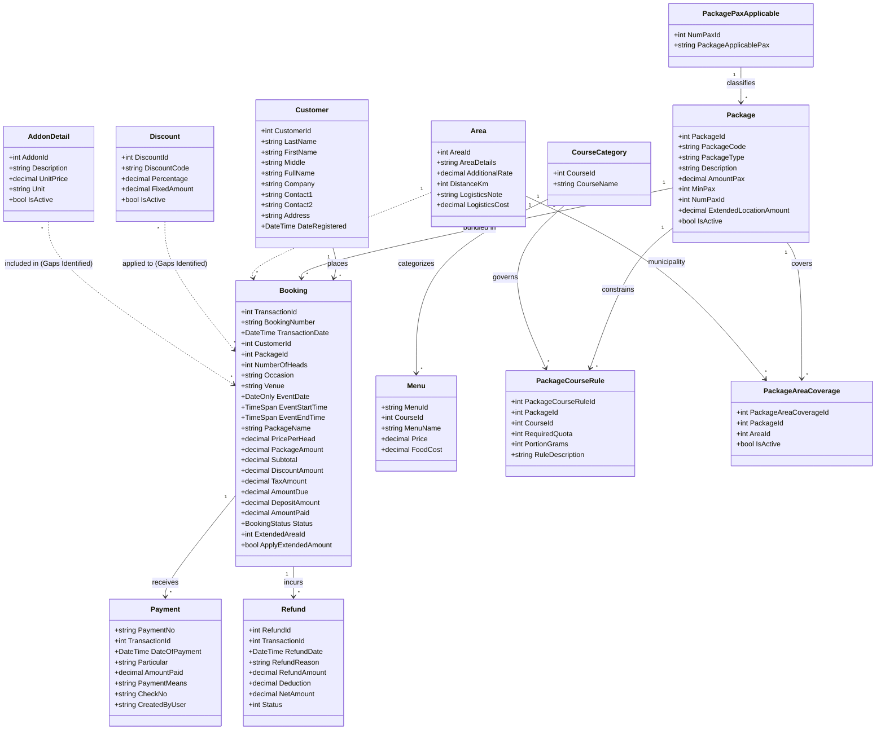

# Sal's CaterSuite — Domain Model & DDD Architecture

## 1. Domain Model Overview

## 1.1 Audit Fields — `BaseEntity` (DEC-038)

Every domain entity inherits `SalsCaterSuite.Domain.Common.BaseEntity`, which declares the four
audit fields once for the whole model (entities must never redeclare them):

| Property | CLR type | Nullable | Persisted as | Notes |
| :--- | :--- | :--- | :--- | :--- |
| `CreatedDate` | `DateTime?` | yes | per-table column (see dictionary) | initialised to `DateTime.UtcNow` |
| `CreatedByUser` | `string?` | yes | per-table column (see dictionary) | `NVARCHAR(100)` |
| `UpdatedDate` | `DateTime?` | yes | per-table column (see dictionary) | |
| `IsDeleted` | `bool` | no | per-table column (see dictionary) | `BIT NOT NULL`, `DEFAULT 0` |

Entities inheriting `BaseEntity`: `Booking`, `Customer`, `Menu`, `Package`, `Payment`, `Refund`,
`Reservation`, `Area`, `CourseCategory`, `AddonDetail`, `Discount`, `PackageCourseRule`,
`PackageAreaCoverage`, and `PackagePaxApplicable` (DEC-173).

Column names preserve each table's existing audit convention where one exists
(`Booking` → `b_createdbyUser` / `b_createdDate` / `b_updatedDate`, `Payment` → `p_*`,
`Package` and `Discount` → `date_Created` / `date_Updated`); all remaining tables use the
documented generic pattern `createdDate`, `createdByUser`, `updatedDate`, `is_deleted`.
The complete table → column mapping lives in `business/data-dictionary.md`.

Behaviour: `IsDeleted` is **stored only**. No global query filter and no soft-delete behaviour
is configured — adding one would be an unapproved behaviour change.

## 2. Aggregate Roots & Invariants

### 2.1 Booking Aggregate
- **Root:** `Booking`
- **Child Entities:** `Payment`, `Refund`, (Proposed: `BookingAddon`, `BookingDiscount`, `BookingMenu`)
- **Invariants:**
  1. `NumberOfHeads` must be $> 0$.
  2. `EventEndTime` must not precede `EventStartTime`.
  3. A booking in `Completed` status cannot be cancelled; a cancelled booking cannot be cancelled again (BR-06).
  4. A refund cannot exceed the total payments received for the booking (BR-06, DEC-024).
  5. Base price is snapshotted upon booking creation (BR-04).
  6. `Status` is the single lifecycle field (BR-10). The legacy `ServeStatus` / `IsCancelled` boolean pair is **retired** and must not be reintroduced.
  7. `BookingNumber` is assigned once and is never re-used (BR-09, DEC-016).

> **Reporting basis.** `AmountDue` is the frozen stored net amount due, but the
> **authoritative** net amount due for every report is the shared
> `BookingAmountDueCalculator.Calculate(booking, Σ Payment.AmountPaid)` overload
> (DEC-046). `AmountPaid` on the entity is a denormalized cache and is **not**
> authoritative (DEC-012). DEC-035 remains open for the owner.

### 2.2 Menu Catalog Aggregate
- **Root:** `Menu`
- **Associated:** `CourseCategory`
- **Invariants:**
  1. `MenuId` is unique and non-empty.
  2. `FoodCost >= 0` and `Price >= 0`.

### 2.3 Customer Aggregate
- **Root:** `Customer`
- **Associated:** `Booking`, `Reservation`
- **Invariants:**
  1. First and Last name are required.
  2. At least one valid contact method must be provided. **Not enforced** — no validator, domain guard or database constraint applies it, and enforcing it would reject existing records. Raised for the owner as **DEC-054**.

> **Not customer attributes.** A customer has **no** code, tax identification number,
> tier, metro area, email address, point-of-contact name/role, credit terms, status or
> lifetime-value figure. The Customer Master's *Customer Classification* is **derived**
> from `Company` (DEC-051) and its *aging state* is derived from the customer's
> bookings (DEC-052); neither is a stored attribute.

## 3. Architectural Gap Analysis: Missing Junctions

In the legacy database and current EF Core setup, `AddonDetail` and `Discount` are isolated tables with no EF navigation to `Booking`.
To support accurate contract calculations, the following junction entities must be mapped:
- `BookingAddon`: (`TransactionId`, `AddonId`, `Quantity`, `UnitPriceSnapshot`)
- `BookingDiscount`: (`TransactionId`, `DiscountId`, `DiscountAmountSnapshot`)
- `BookingMenu`: (`TransactionId`, `MenuId`, `CourseId`)

Until these junctions are wired, `PaymentLedgerService` and `CalendarController` will pass placeholder values, suppressing accurate ledger reconciliation.

---

## 2.4 Package Configuration Aggregate (added by REQ-PKG-02, 2026-10-22)

The owner approved a domain extension on 2026-10-22 (DEC-077) so that the Package Editor & Course
Category Rules workbench and the Package Location & Out-of-Town Add-On matrix could be built on
real data instead of fabricated figures.

### 2.4.1 `PackageCourseRule` - the enforced rule for one course

| Property | Type | Nullable | Notes |
| :--- | :--- | :--- | :--- |
| `PackageCourseRuleId` | `int` | no | Identity key. |
| `PackageId` | `int` | no | FK to `Package`. Cascade delete. |
| `CourseId` | `int` | no | FK to `CourseCategory`. |
| `RequiredQuota` | `int` | no | >= 1. The dishes the client must take from the course. |
| `PortionGrams` | `int?` | yes | The standard portion per guest. |
| `RuleDescription` | `string` | no | The rule in plain words. |
| audit | `BaseEntity` | | DEC-038. |

**Invariants.** A live ruleset holds **at most one** rule per course. `RequiredQuota >= 1`. A rule
removed from a submitted set is **soft-deleted**, never destroyed (DEC-085).

The rule does not carry an inclusion label or an add-on association (DEC-172). `AddonDetail` remains independent of course rules; booking add-on lines retain their separate approved relationship and semantics.

**Derived, not stored.** The rule's *qualified pool* is every non-soft-deleted `Menu` whose
`CourseId` matches the rule's course. The pool is a query, not a relationship: the menu catalogue
grows and shrinks on its own, and a stale stored pool would be wrong the moment the kitchen adds a
dish.

### 2.4.2 `PackageAreaCoverage` - the link to a municipality

| Property | Type | Nullable | Notes |
| :--- | :--- | :--- | :--- |
| `PackageAreaCoverageId` | `int` | no | Identity key. |
| `PackageId` | `int` | no | FK to `Package`. Cascade delete. |
| `AreaId` | `int` | no | FK to `Area`. Cascade delete. |
| `IsActive` | `bool` | no | Whether the tier is currently offered there. |
| audit | `BaseEntity` | | DEC-038. |

**Invariants.** A live coverage set holds **at most one** row per municipality. The row carries
**no money**: the per-pax surcharge is `Area.AdditionalRate`, the municipality's own rate, because
that is already the rate BR-01 charges on a booking with an extended area. One rate, one meaning,
one place (DEC-078).

### 2.4.3 The extended `Area` - the municipality catalogue

`Area` gains three optional columns: `DistanceKm` (`int?`), `LogisticsNote` (`string?`) and
`LogisticsCost` (`decimal?`, the **per-event** logistics cost). All three are `null` when the
municipality has not stated them, and a null logistics cost **omits** the logistics band from the
gross-profit split rather than reporting a zero (DEC-081).

### 2.4.4 What is deliberately **not** in the aggregate

- **No stored per-tier food cost or margin.** The food cost is always derived - from a dish
  selection, or from the standard-run estimate (DEC-083). A stored figure would be a commitment
  the kitchen has not made.
- **No persisted client selection.** The selection is a preview; a proposal is a document, not a
  database row.
- **No per-package rate override** and **no guest ceiling** on `Package` (open questions 1 and 5
  in the specification).
- **No seeded rule, coverage row or municipality** (BR-13).

## 2.5 Package applicable-pax classification (REQ-PKG-04, DEC-173)

`Package` has a required `NumPaxId` foreign key to `PackagePaxApplicable`. The lookup key and
label are fixed reference data; its five IDs and labels are specified in
`business/packages-catalogue-feature-spec.md` §3.1.1 and are seeded by the migration. The lookup
entity inherits `BaseEntity` and carries the standard DEC-038 audit columns.

This relationship classifies a tier only. The label is not parsed as a numeric interval and does
not constrain `PackageType`, `MinPax`, booking headcount, booking eligibility or pricing. Existing
tiers are backfilled only by the owner-approved `p_id` mapping recorded in DEC-173; an unmapped
row makes the migration fail rather than receive an inferred classification.
