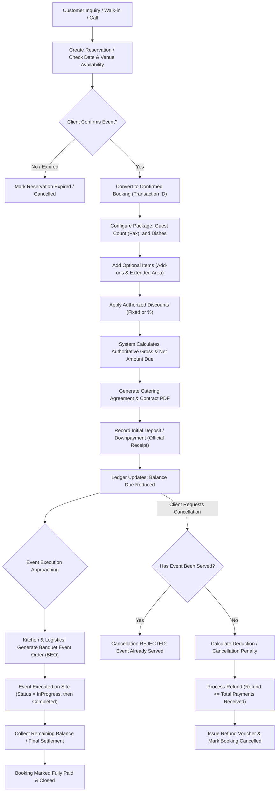

# Sal's CaterSuite — End-to-End Catering Business Processes

## 1. Process Phases & Actors

### Phase 1: Inquiry & Date Feasibility
- **Actors:** Client, Sales Coordinator / Front Desk
- **Actions:** Client inquires about date, venue, and estimated guest count. Sales coordinator checks calendar for venue conflicts and logs a `Reservation`.

### Phase 2: Booking Confirmation & Contract Finalization
- **Actors:** Sales Coordinator, Client, Catering Manager
- **Actions:**
  1. A formal `Booking` is created with a unique `TransactionId`.
  2. Package is selected (Regular, VIP, Wedding, etc.) with specified Pax.
  3. Dishes are assigned across course categories (Soup, Salad, Entrees, Dessert, Drinks).
  4. Supplementary options (tents, extra staff, sound system) are attached as `AddonDetail`.
  5. If the event is outside normal delivery range, `ApplyExtendedAmount` is enabled with designated `Area`.
  6. Any approved promotional or managerial discount is applied.
  7. Server computes authoritative `GrossAmount` and `NetAmountDue`.
  8. Legal Catering Contract is rendered via QuestPDF.

### Phase 3: Deposit & Payment Lifecycle
- **Actors:** Client, Cashier / Finance
- **Actions:**
  1. Client pays downpayment or installment via Cash, Check, GCash, Bank Transfer, or Credit Card.
  2. Cashier enters payment in `PaymentsController`.
  3. System assigns unique `PaymentNo` (`OR-YYYYMMDD-XXXX`), logs timestamp and cashier username.
  4. Ledger recomputes `TotalPaymentsReceived` and `RemainingBalance`.
  5. QuestPDF generates printable Official Receipt / Payment Voucher.

### Phase 4: Operational Preparation & Kitchen Execution
- **Actors:** Head Chef, Kitchen Stewards, Banquet Floor Manager
- **Actions:**
  1. Prior to event, Kitchen BEO Document is generated.
  2. Kitchen calculates ingredient requirements based on pax count and dish portions.
  3. Banquet manager verifies venue setup, tables, linens, and add-on equipment.
  4. While the event is running the booking's lifecycle status is `InProgress`; once food service is rendered it becomes `Completed` (BR-10 — the legacy `ServeStatus` boolean is retired and must not be reintroduced). **There is no API for this transition today** (DEC-036).

### Phase 5: Post-Event Settlement & Financial Reporting
- **Actors:** Cashier, Accountant, Business Owner
- **Actions:**
  1. Final billing statement / Statement of Account (SOA) is settled.
  2. In case of overdue corporate receivables, aging reports are tracked.
  3. Management exports Monthly Catering Report (ClosedXML) reconciling revenue, collections, and outstanding receivables.

