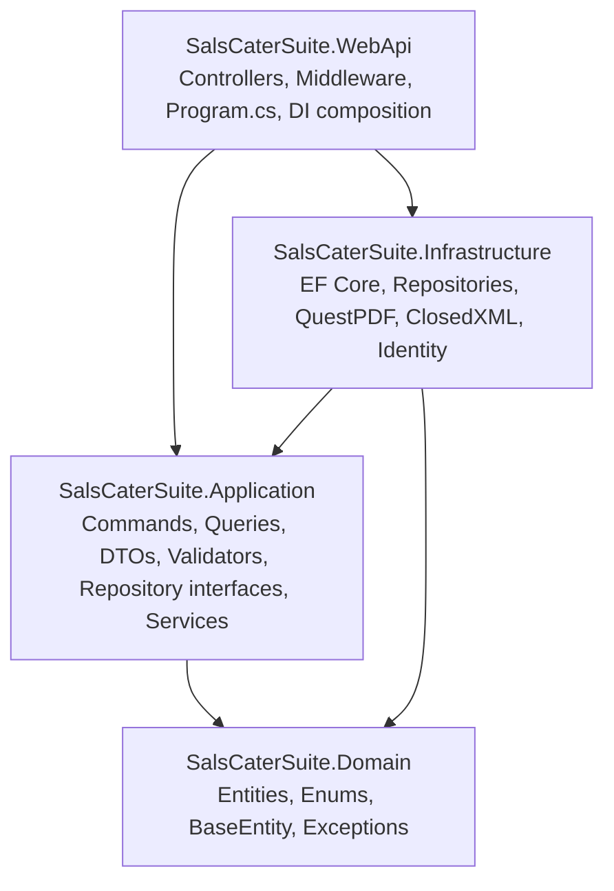

# Project Structure Workplan: Sal's CaterSuite

**Canonical path:** `docs/salscatersuite_project_structure_workplan.md`
**Document owner:** AGENT 01 — Sal's CaterSuite Business Intelligence Architect (skill `bi-architect`)
**Audience:** AGENT 01 (BI Architect), AGENT 02 (.NET Backend Architect Developer), AGENT 03 (React UI/UX Frontend Developer), the Debater plan-review sub-agent
**Authority:** This document is the **single source of truth for the repository layout, the module boundaries, the build/run/test commands, and the development workflow** of Sal's CaterSuite.

| Field | Value |
| :--- | :--- |
| **Application Name** | Sal's CaterSuite |
| **Repository Root** | `D:\source\repos\SalsCaterSuite` |
| **Database Name** | `SalsCaterSuiteDb` |
| **Data Context** | `SalsCaterSuiteDbContext` |
| **Backend** | ASP.NET Core Web API — **.NET 10** (`net10.0`), Clean Architecture |
| **Solution File** | `src/backend/SalsCaterSuite.slnx` (XML solution format) |
| **Frontend** | **React 19** + Vite 8 + TypeScript 6 + Tailwind CSS 4 |
| **Database Engine** | SQL Server (Development target: LocalDB `MSSQLLocalDB`) |
| **Test Projects** | `src/backend/SalsCaterSuite.UnitTests` (xUnit), `src/backend/SalsCaterSuite.IntegrationTests` (xUnit + `WebApplicationFactory`) |
| **Status** | Living document — aligned to the **as-built** repository state |
| **Last aligned** | 2026-10-22 (AGENT 01 — the **source-control migration** (DEC-125) and the **test-project relocation** (DEC-126) are **closed**: the repository root is the monorepo root, the whole monorepo is under version control, the `**/[Pp]ackages/*` template rule no longer hides the package-configuration module, and both test projects now live under `src/backend/`. Verified by a **clean clone of the remote**: backend build **0 W / 0 E**, **823/823** unit, **133/133** integration, **327/327** Vitest, frontend build green. §1, §1.2, §2.1, §2.6, §7.3, §10 and §11 were realigned to the as-built state in this cycle.)<br>2026-10-22 (AGENT 01 - the **REQ-BKG-05 / REQ-BKG-01 Bookings & Events Register & Reservation Workbench** cycle is **closed**. The Debater plan review returned `PROPOSE_BETTER_PLAN` with **eight blocking findings**; **all eight were applied** and the specification was reissued as **v1.1**. The delivery added a new frontend feature folder, two routes, a client endpoint group, six backend endpoints, one purely additive migration and two absent-by-default configuration keys (DEC-114); **DEC-035 is resolved** - one net-due source, one rounding - the out-of-town surcharge is charged and stored, the soft-deleted-payment exclusion is unified across every money surface, and BR-05 overpayment prohibition is enforced. **Seven review rounds and a live end-to-end validation** found **two defects the suites could not see**, both fixed and pinned; the second is now guarded by a **DTO projection guard** that is proved by execution. AGENT 01 own verification: **823/823** unit, **133/133** integration, **327/327** Vitest, **0** TypeScript errors, **0** warnings / **0** errors, and **52/52** live assertions against a disposable database. Sections 2.2-2.6, 3.1-3.4, 4, 7.3, 7.4, 9, 10 and 11 were realigned to the as-built state in this cycle.) |

> **Read this document before acting.** If the code and this document disagree, **the code is the current truth and this document is stale**. AGENT 01 realigns the document as part of closing the work cycle. A sub-agent that finds a discrepancy must report it to AGENT 01 and must **not** silently treat either side as correct.

---

## 0. Source-of-Truth Contract and Maintenance Protocol

### 0.1 What this document governs

This document owns:

1. The **repository layout** — every top-level folder and the owning project of each subtree.
2. The **backend module boundaries** — what lives in Domain, Application, Infrastructure, WebApi, and the dependency direction between them.
3. The **frontend feature layout** — which feature folders exist, which pages/components/hooks/types belong to each, and the route table.
4. The **API surface** — the endpoint paths the client is allowed to call.
5. The **build, run and test commands** — the only supported entry points.
6. The **development workflow** — the AGENT 01 → Debater → AGENT 02/03 → Review → Validate → Close cycle and the artifacts each stage owns.

This document does **not** govern business rules, financial formulas, KPI definitions or API payload shapes. Those live in `business/business-rules.md`, `business/kpi-catalog.md` and `architecture/approved-api-contracts.md`.

### 0.2 Mandatory read for every sub-agent

Before implementing, reviewing or scaffolding anything, AGENT 02, AGENT 03 and the Debater must read this document and confirm that their task:

- places files **only** inside the folders listed for their layer;
- introduces **no new project**, **no new root-level folder** and **no new top-level package** without an AGENT 01 decision recorded in `governance/decision-log.md`;
- uses the **existing** build/run/test commands from §7;
- does not contradict a rule in §2 (backend boundaries) or §3 (frontend layout).

### 0.3 When AGENT 01 must realign this document

Update this document in the same cycle, **before** the feature is closed, whenever any of the following changes:

| Trigger | Section to update |
| :--- | :--- |
| A new backend project, or a change to a project reference | §1, §2 |
| A new Application feature module | §2.3 |
| A new Domain entity or enum | §2.2 |
| A new repository interface or implementation | §2.3, §2.4 |
| A new controller, or a removed controller | §2.5 |
| A new document generator or export | §2.4 |
| A new frontend feature folder, page, or shared component | §3 |
| A route added, renamed or removed | §3.3 |
| A new client endpoint | §3.4 |
| A new migration, or a change to the entity set | §4 |
| A new test project or test-root location | §2.6 |
| A new command, port, or configuration key | §7 |
| A new governance artifact folder or file | §5 |
| A change to the agent/tooling layout | §6 |
| A change to the workflow stages or artifacts | §8 |
| Any change to the delivered-feature state | §9 |

### 0.4 Realignment procedure

1. Diff the **as-built** repository against the corresponding section of this document (file enumeration, not recollection).
2. Apply the structural change to the code first, or in the same commit as this document.
3. Update the affected section(s) and the **change log** in §10.
4. Record the decision in `governance/decision-log.md` when the change is structural or affects a boundary (new project, new layer dependency, new root folder). A change that only moves a file inside an existing feature folder does **not** need a decision entry.
5. Re-verify the two claims in §11 and update the "Last aligned" row in the header table.

### 0.5 Anti-drift rules

- Do **not** describe a folder as "planned", "to be created" or "will be" in a way that implies it already exists. Mark it **`PLANNED — not yet implemented`**.
- Do **not** delete a section because a feature is unfinished. Replace the content with the as-built state and record the gap in §9 or `implementation/feature-status.md`.
- Do **not** record unverified test counts. Copy them from an actual run.
- If a structure change is proposed by AGENT 02 or AGENT 03, it is **not** in effect until AGENT 01 updates this document.

---

## 1. High-Level Repository Layout

The repository houses the modern stack under `src/`, keeps the two test projects **inside the backend** at `src/backend/` (they are part of the backend implementation — DEC-126), and keeps all governance documentation in first-class folders at the root.

```
D:\source\repos\SalsCaterSuite\
│
├── .agents\                          <-- Agent definitions, rules and skills (AGENT 01/02/03, Debater)
├── architecture\                     <-- approved-api-contracts.md, domain-model.md
├── business\                         <-- Requirements, rules, glossary, data dictionary, KPI catalog, feature specs
├── db\scripts\                       <-- Operational SQL scripts (backfill-booking-numbers.sql)
├── docs\                             <-- THIS document + project documentation
├── governance\                       <-- decision-log.md, risk-register.md, requirements-traceability.md
├── implementation\                   <-- feature-status.md, acceptance-test-scenarios.md
├── scripts\                          <-- dev.mjs — the API + UI development orchestrator
│
├── src\
│   ├── backend\                      <-- .NET 10 Clean Architecture solution
│   │   ├── SalsCaterSuite.slnx
│   │   ├── SalsCaterSuite.Domain\
│   │   ├── SalsCaterSuite.Application\
│   │   ├── SalsCaterSuite.Infrastructure\
│   │   ├── SalsCaterSuite.WebApi\
│   │   ├── SalsCaterSuite.UnitTests\       <-- the unit-test project (belongs to the backend)
│   │   └── SalsCaterSuite.IntegrationTests\ <-- the integration-test project (belongs to the backend)
│   │
│   └── frontend\
│       └── salscatersuite-ui\        <-- React 19 + Vite 8 + TypeScript SPA
│
├── AGENTS.md                         <-- The agent hierarchy & governance rules (all three agents)
├── opencode.json.example             <-- Versioned MCP configuration template (Context7, no secret)
├── package.json                      <-- Root task runner (no dependencies)
├── README.md                         <-- Run & configuration guide
├── .gitattributes                    <-- Repository-wide line-ending and binary rules
├── .gitignore                        <-- Repository-root ignore rules (see §1.2)
└── .git\                             <-- THE Git repository root (see §1.2)
```

> `opencode.json` also exists at the root, but it is **not versioned** — it carries the live Context7 MCP bearer token. `opencode.json.example` is the versioned, secret-free template (§1.2).

### 1.1 Legacy system

The legacy ASP.NET MVC 5 application `SBOSysTacV2` is **preserved intact** and is **not** part of this repository. It is a separate repository (`D:\source\repos\SBOSysTacV2`). The legacy `AspNetUsers` credential format is honoured by `Infrastructure/Identity/LegacyPasswordHasher.cs` (DEC-028). The legacy **data import** has not started and requires an approved mapping (DEC-032).

### 1.2 Version control layout

**The Git repository root IS the repository root.** `.git\` sits at `D:\source\repos\SalsCaterSuite\.git` — the **same** folder that holds `src\`, `tests\`, `docs\`, `governance\` and the root files. There is **one** repository and **one** remote for the whole monorepo.

| Property | Value |
| :--- | :--- |
| **Remote** | `https://github.com/AladdineAlcala/SalsCaterSuite.git` |
| **Branch** | `master` |
| **Repository root** | `D:\source\repos\SalsCaterSuite` (`.git\` at the root — **not** inside `src\backend\`) |
| **Backend project files** | `src/backend/**` |
| **Frontend project files** | `src/frontend/salscatersuite-ui/**` |
| **Test project files** | `src/backend/SalsCaterSuite.UnitTests/**`, `src/backend/SalsCaterSuite.IntegrationTests/**` (the test projects are **part of the backend implementation** — DEC-126) |
| **Governance artifacts** | `business/`, `architecture/`, `governance/`, `implementation/`, `docs/`, `.agents/`, `db/`, `scripts/` |
| **Root ignore rules** | `.gitignore` (repository-wide) + `src/backend/.gitignore` (backend-scoped) + `src/frontend/salscatersuite-ui/.gitignore` (frontend-scoped) |

**Rules that bind every agent:**

1. **No nested repository.** A `.git` directory may exist **only** at the repository root. Never initialise a repository inside `src/backend/` or `src/frontend/salscatersuite-ui/` — a nested repository is invisible to the outer one and silently removes the subtree from the remote.
2. **The remote must be able to build the product.** Every source file that the build needs must be tracked. Before closing a cycle, confirm with a **clean clone** that `npm run build` succeeds — a green local build proves nothing, because a missing file can only be a missing file in the clone.
3. **Never trust a template ignore rule for a folder the product owns.** A pattern copied from a generic template can match a *source* folder. `src/backend/.gitignore` carried `**/[Pp]ackages/*` (intended for a NuGet restore folder), which matched the source folder `SalsCaterSuite.Application/Features/Packages` and excluded the **entire** package-configuration module from the remote (DEC-125).
4. **Secrets are never tracked.** `opencode.json` carries a live bearer token and is ignored; `opencode.json.example` is the versioned template.

---

## 2. Backend Clean Architecture Structure (.NET 10)

### 2.0 Dependency graph



**Hard rules (DEC-037):**

- The **Application** project must **not** reference `Microsoft.EntityFrameworkCore` or any Identity package. It expresses persistence needs in its own repository interfaces, using Domain entities and Application DTOs/projections only.
- `ISalsCaterSuiteDbContext` **no longer exists**. Only the concrete `SalsCaterSuiteDbContext` is used, and only inside `Infrastructure\Persistence` (plus `Infrastructure\DependencyInjection.cs` and `WebApi\Program.cs` for composition).
- `WebApi` and `Application` business logic must not depend on `Infrastructure` business logic; `WebApi` may reference `Infrastructure` for DI composition only.
- `Domain` has **zero** external package dependencies.

### 2.1 Solution file

`src/backend/SalsCaterSuite.slnx` (XML solution format) contains:

| Project | Path |
| :--- | :--- |
| `SalsCaterSuite.Domain` | `SalsCaterSuite.Domain/SalsCaterSuite.Domain.csproj` |
| `SalsCaterSuite.Application` | `SalsCaterSuite.Application/SalsCaterSuite.Application.csproj` |
| `SalsCaterSuite.Infrastructure` | `SalsCaterSuite.Infrastructure/SalsCaterSuite.Infrastructure.csproj` |
| `SalsCaterSuite.WebApi` | `SalsCaterSuite.WebApi/SalsCaterSuite.WebApi.csproj` |
| `SalsCaterSuite.UnitTests` | `SalsCaterSuite.UnitTests/SalsCaterSuite.UnitTests.csproj` |

The integration-test project is **not** in the `.slnx`; it is run explicitly (§7).

### 2.2 Project 1 — `SalsCaterSuite.Domain` (Core Business Rules)

* **Target:** `net10.0` (class library) · **Dependencies:** none
* **As-built structure:**

```
SalsCaterSuite.Domain/
├── Common/
│   └── BaseEntity.cs                 (Id + CreatedDate, CreatedByUser, UpdatedDate, IsDeleted — DEC-038)
├── Entities/                         (13 — every one inherits BaseEntity)
│   ├── AddonDetail.cs
│   ├── Area.cs
│   ├── Booking.cs                    (the four frozen columns of REQ-BKG-05 — DEC-106, DEC-116:
│   │                                  CallTime, PackoutTime, DiscountCode, ExtendedAreaAmount)
│   ├── CourseCategory.cs
│   ├── Customer.cs
│   ├── Discount.cs
│   ├── Menu.cs
│   ├── Package.cs
│   ├── PackageAreaCoverage.cs        (REQ-PKG-02, DEC-077)
│   ├── PackageCourseRule.cs         (REQ-PKG-02, DEC-077)
│   ├── Payment.cs
│   ├── Refund.cs
│   └── Reservation.cs
├── Enums/
│   ├── BookingStatus.cs
│   ├── BookingType.cs
│   ├── DiscountType.cs
│   ├── PackageType.cs
│   ├── PaymentMeans.cs
│   ├── RecievableType.cs
│   ├── RefundStatus.cs
│   └── ServiceType.cs
└── Exceptions/
    ├── BusinessRuleValidationException.cs
    └── DomainException.cs
```

* `Domain.Enums.UserRoleEnum` was **removed** (DEC-022). The canonical role vocabulary is `Application/Common/Authorization/AuthorizationPolicies.cs` (DEC-017).
* No EF Core attribute, no `DbSet`, no `IQueryable` in this project.

### 2.3 Project 2 — `SalsCaterSuite.Application` (Business Orchestration & Use Cases)

* **Target:** `net10.0` (class library)
* **Dependencies:** `SalsCaterSuite.Domain`, `FluentValidation.DependencyInjectionExtensions` `11.9.2`
* **As-built structure:**

```
SalsCaterSuite.Application/
├── DependencyInjection.cs             (AddApplicationServices — validators, use cases)
├── Common/
│   ├── Authorization/
│   │   └── AuthorizationPolicies.cs   (single source of role names and policy names — DEC-017)
│   ├── Interfaces/                    (16 repository / service contracts)
│   │   ├── IAuthenticationRepository.cs
│   │   ├── IAreaRepository.cs            (REQ-PKG-02, DEC-077)
│   │   ├── IBookingPolicyProvider.cs     (the two deployment-configured figures — DEC-101, DEC-102)
│   │   ├── IBookingRepository.cs
│   │   ├── ICourseCategoryRepository.cs
│   │   ├── ICurrentUserService.cs
│   │   ├── ICustomerRepository.cs
│   │   ├── IDateTime.cs
│   │   ├── IDiscountRepository.cs        (the discount catalogue, read by code — DEC-114)
│   │   ├── IFoodCostBenchmarkProvider.cs
│   │   ├── IMenuRepository.cs
│   │   ├── IPackageRepository.cs
│   │   ├── IPackageAreaCoverageRepository.cs  (REQ-PKG-02, DEC-077)
│   │   ├── IPackageCourseRuleRepository.cs   (REQ-PKG-02, DEC-077)
│   │   ├── IPaymentRepository.cs
│   │   └── IRefundRepository.cs
│   └── Models/
│       ├── AuthenticatedUser.cs
│       ├── AuthenticationAttempt.cs
│       ├── FoodCostBenchmark.cs
│       ├── MenuCostingAggregate.cs
│       ├── MenuCourseCostAggregate.cs
│       ├── PaginatedList.cs
│       ├── PaymentRangeAggregate.cs
│       └── Result.cs
├── Features/
│   ├── Bookings/
│   │   ├── BookingCreateCapabilities.cs (the extended create path's collaborators — DEC-114)
│   │   ├── Commands/     (CancelBookingCommand, CreateBookingCommand, PreviewBookingQuoteCommand)
│   │   ├── DTOs/        (BookingDto, BookingQuoteDto, BookingRegisterPageDto,
│   │   │                BookingRegisterSummaryDto, CreateBookingResponseDto)
│   │   ├── Models/      (BookingRegisterFilter, BookingRegisterFilterRequest, BookingRegisterSort)
│   │   ├── Queries/     (GetBookingDetailsQuery, GetBookingLedgerQuery, GetBookingRegisterQuery,
│   │   │                GetBookingRegisterSummaryQuery)
│   │   ├── Services/    (BookingCapacityWindow, BookingPaymentPopulation, BookingPaymentStateClassifier,
│   │   │                BookingPricingService, BookingRegisterPopulationService,
│   │   │                BookingRegisterProjection, BookingTierEstimateService)
│   │   └── Validators/  (BookingQuoteValidator.cs, BookingRegisterFilterValidator.cs,
│   │                    CreateBookingValidator.cs)
│   ├── Calendar/
│   │   ├── DTOs/        (CalendarEventDto)
│   │   └── Queries/     (GetCalendarEventsQuery)
│   ├── Customers/
│   │   ├── Commands/    (CreateCustomerCommand, UpdateCustomerCommand)
│   │   ├── DTOs/        (CustomerDirectoryDto, CustomerDto)
│   │   ├── Queries/     (GetCustomerByIdQuery, GetCustomerDirectoryQuery, GetCustomersQuery, GetCustomerStatementQuery)
│   │   ├── Services/    (CustomerAgingService.cs — the single aging vocabulary)
│   │   ├── Validators/  (CreateCustomerValidator.cs)
│   │   └── (CustomerClassification.cs, CustomerNotFoundResult.cs)
│   ├── Dashboard/
│   │   ├── DTOs/        (DashboardDto)
│   │   ├── Models/      (DashboardPeriod)
│   │   ├── Queries/     (GetDashboardQuery)
│   │   ├── Services/    (DashboardService.cs, IDashboardService.cs)
│   │   └── (DashboardErrors.cs, DashboardNotFoundResult.cs)
│   ├── Menus/
│   │   ├── Commands/    (CreateMenuCommand, DeleteMenuCommand, UpdateMenuCommand)
│   │   ├── DTOs/        (MenuDto, MenuMasterDto)
│   │   ├── Models/      (MenuMasterDataSet, MenuMasterFilter, MenuMasterSort, MenuMasterStatus)
│   │   ├── Queries/     (GetCoursesQuery, GetMenuByIdQuery, GetMenuMasterQuery, GetMenusQuery, PreviewMenuCostingQuery)
│   │   ├── Services/    (IMenuCostingService.cs, MenuCostingCalculator.cs)
│   │   ├── Validators/  (MenuCostingPreviewValidator.cs, MenuRequestValidator.cs)
│   │   └── (MenuDuplicateResult.cs, MenuNotFoundResult.cs)
│   ├── Packages/
│   │   ├── Commands/    (AttachPackageAreaCoverageCommand, CreateAreaCommand, CreatePackageCommand,
│   │   │                ReplacePackageAreaCoverageCommand, ReplacePackageCourseRulesCommand,
│   │   │                TogglePackageActiveCommand, UpdateAreaCommand, UpdatePackageCommand)
│   │   ├── DTOs/        (AreaDto.cs, PackageAreaCoverageDto.cs, PackageCatalogueSummaryDto.cs,
│   │   │                PackageCourseRulePreviewDto.cs, PackageCourseRulesetDto.cs, PackageDto.cs,
│   │   │                PackageLocationPreviewDto.cs, PackageRepositoryProjections.cs,
│   │   │                PackageSpecSheetModel.cs)
│   │   ├── Queries/     (GetAreasQuery, GetPackageAreaCoverageMatrixQuery, GetPackageByIdQuery,
│   │   │                GetPackageCatalogueSummaryQuery, GetPackageCourseRulesetQuery,
│   │   │                GetPackageSpecSheetQuery, GetPackagesQuery, PreviewPackageCourseRuleQuery,
│   │   │                PreviewPackageLocationQuery)
│   │   ├── Services/    (PackageCostingCalculator.cs - the single arithmetic, REQ-PKG-02)
│   │   ├── Validators/  (AreaRequestValidator.cs, PackageAreaCoverageEntryValidator.cs,
│   │   │                PackageAreaCoverageRequestValidator.cs, PackageCourseRulePreviewValidator.cs,
│   │   │                PackageCourseRuleRequestValidator.cs, PackageCourseRulesetRequestValidator.cs,
│   │   │                PackageLocationPreviewValidator.cs, PackageRequestValidator.cs)
│   │   └── (AreaNotFoundResult.cs, PackageNotFoundResult.cs)
│   └── Payments/
│       ├── DTOs/        (PaymentEntryDto)
│       ├── Services/    (IPaymentLedgerService.cs, PaymentLedgerService.cs — the authoritative ledger,
│       │                ReceiptNumberGenerator.cs — the one receipt-number generator, DEC-112)
│       └── Validators/  (RecordPaymentValidator.cs)
└── Services/
    └── BookingAmountDueCalculator.cs (the single net-due calculation — DEC-046; the one rounding of
        the money chain — DEC-115; the stored surcharge — DEC-116)
```

**Rules:**

- A use case never touches EF Core, `DbContext` or SQL. It composes repository calls and returns an `Application` result/DTO.
- A financial calculation that appears in more than one place lives in **one** shared class (`BookingAmountDueCalculator`, `MenuCostingCalculator`, `CustomerAgingService`) and is reused by every caller.
- A validator is executed by the use case before persistence; a `DomainException` maps to **HTTP 400** (DEC-014).

### 2.4 Project 3 — `SalsCaterSuite.Infrastructure` (Data, Third-Party Tools, Persistence)

* **Target:** `net10.0` (class library) · `FrameworkReference: Microsoft.AspNetCore.App`
* **Packages:** `Microsoft.EntityFrameworkCore.SqlServer` `10.0.13`, `Microsoft.EntityFrameworkCore.Design` `10.0.13` (design-time only), `Microsoft.AspNetCore.Identity.EntityFrameworkCore` `10.0.13`, `QuestPDF` `2024.12.1`, `ClosedXML` `0.104.2`, `System.Security.Cryptography.Pkcs` `10.0.13` (DEC-027 security pin)
* **As-built structure:**

```
SalsCaterSuite.Infrastructure/
├── DependencyInjection.cs             (AddInfrastructureServices — the only composition root for EF/Identity/exports)
├── Documents/                         (QuestPDF)
│   ├── ContractDocument.cs            (the money block renders the shared calculator's figures — DEC-113)
│   ├── PackageSpecSheetDocument.cs      (REQ-PKG-02 — the tier's printable specification sheet)
│   ├── KitchenBeoDocument.cs
│   ├── PaymentVoucherDocument.cs
│   ├── RefundVoucherDocument.cs
│   └── StatementOfAccountDocument.cs
├── Exports/                           (ClosedXML)
│   ├── BookingRegisterExport.cs        (REQ-BKG-05 — the register XLSX, contract §14.6)
│   ├── CateringMonthlyReportExport.cs
│   ├── CollectionSummaryExport.cs
│   ├── CustomerDirectoryExport.cs
│   └── MenuFoodCostingExport.cs
├── Identity/
│   ├── ApplicationUser.cs
│   └── LegacyPasswordHasher.cs        (legacy v2 PBKDF2 compatibility — DEC-028)
├── Persistence/
│   ├── SalsCaterSuiteDbContext.cs
│   ├── SalsCaterSuiteDbContextFactory.cs  (design-time factory for `dotnet ef`)
│   ├── IDatabaseSeeder.cs
│   ├── Configurations/
│   │   ├── AreaConfiguration.cs             (REQ-PKG-02 — the municipality catalogue)
│   │   ├── BookingConfiguration.cs          (the four frozen columns of REQ-BKG-05 — DEC-106, DEC-116)
│   │   ├── CustomerConfiguration.cs
│   │   ├── MenuConfiguration.cs
│   │   ├── PackageAreaCoverageConfiguration.cs (REQ-PKG-02 — the filtered unique index, DEC-088)
│   │   ├── PackageConfiguration.cs
│   │   ├── PackageCourseRuleConfiguration.cs   (REQ-PKG-02 — the filtered unique index, DEC-088)
│   │   └── PaymentConfiguration.cs
│   ├── Migrations/
│   │   ├── 20261018123605_InitialCreate.cs (+ .Designer.cs)
│   │   ├── 20261018225634_AddAuditColumnsToDomainEntities.cs (+ .Designer.cs)
│   │   ├── 20261018231318_AddDefaultToBookingIsDeleted.cs (+ .Designer.cs)
│   │   ├── 20261021205149_AddPackageConfigurationWorkbench.cs (+ .Designer.cs)
│   │   ├── 20261022050449_AddBookingsEventsRegister.cs (+ .Designer.cs)  (REQ-BKG-05 — the four
│   │   │   additive Booking columns; generated and script-reviewed only, DEC-020, DEC-106, DEC-116)
│   │   └── SalsCaterSuiteDbContextModelSnapshot.cs
│   └── Repositories/                  (the ONLY layer that touches EF Core)
│       ├── AreaRepository.cs                (REQ-PKG-02)
│       ├── AuthenticationRepository.cs
│       ├── BookingRepository.cs             (the register's base population — REQ-BKG-05)
│       ├── CourseCategoryRepository.cs
│       ├── CustomerRepository.cs
│       ├── DatabaseMigrator.cs
│       ├── DatabaseSeeder.cs
│       ├── DiscountRepository.cs            (REQ-BKG-05 — the discount catalogue, read by code)
│       ├── MenuRepository.cs
│       ├── PackageAreaCoverageRepository.cs (REQ-PKG-02)
│       ├── PackageCourseRuleRepository.cs   (REQ-PKG-02)
│       ├── PackageRepository.cs
│       ├── PaymentRepository.cs
│       └── RefundRepository.cs
└── Services/
    ├── ConfigurationBookingPolicyProvider.cs (the two deployment-configured booking figures — DEC-101, DEC-102)
    ├── ConfigurationFoodCostBenchmarkProvider.cs
    ├── DateTimeService.cs
    └── MenuCostingService.cs
```

**Rules:**

- Every repository shares the **one request-scoped `SalsCaterSuiteDbContext`**, so a single `SaveChangesAsync` commits the whole pending change set — there is **no `IUnitOfWork`** (asserted by a DI unit test, DEC-039).
- `DatabaseSeeder` and `DatabaseMigrator` live in the repositories layer. `IDatabaseMigrator` is the only place that calls `DbContext.Database.MigrateAsync` (DEC-020).
- `IFoodCostBenchmarkProvider` is a **singleton** reading `Dashboard:Benchmarks:TargetFoodCostPercentage` so the menu screen and the dashboard can never report different targets (DEC-040).
- **No log message in this project may echo a credential or a contact identifier.** The seeder names the bootstrap administrator by its **id**, never by its login name or e-mail address (DEC-097, BR-21). The rolling log file retained the messages that used to reach only the console.

### 2.5 Project 4 — `SalsCaterSuite.WebApi` (Endpoints, Security, Hosting)

* **Target:** `net10.0` (ASP.NET Core Web API)
* **Dependencies:** `SalsCaterSuite.Application`, `SalsCaterSuite.Infrastructure`, `Microsoft.AspNetCore.Authentication.JwtBearer` `10.0.13`, `Microsoft.AspNetCore.OpenApi` `10.0.13`, `Swashbuckle.AspNetCore` `10.3.0`, `Microsoft.EntityFrameworkCore.Design` `10.0.13` (design-time only), **Serilog.AspNetCore** `10.0.0`, **Serilog** `4.3.0`, **Serilog.Settings.Configuration** `10.0.0`, **Serilog.Sinks.File** `7.0.0`, **Serilog.Sinks.Console** `6.1.1`, **Serilog.Formatting.Compact** `3.0.0` (the operational logging stack — DEC-092)
* **As-built structure:**

```
SalsCaterSuite.WebApi/
├── Controllers/
│   ├── AuthController.cs              (login, current user)
│   ├── AreasController.cs              (the municipality catalogue — REQ-PKG-02, DEC-077)
│   ├── BookingsController.cs          (CRUD, status, calculation, menus — plus the Bookings & Events
│   │                                  Register: the paged dossier, the summary aggregate, the quote,
│   │                                  the contract PDF and the register XLSX — REQ-BKG-05, contract §14)
│   ├── CalendarController.cs          (FullCalendar event feed)
│   ├── CustomersController.cs         (profiles, directory, receivables, SOA, exports)
│   ├── DashboardController.cs         (GET /api/dashboard aggregate — REQ-DSH-01)
│   ├── MenusController.cs             (dishes, categories, food costing, master, exports)
│   ├── PackagesController.cs          (buffet packages, the catalogue aggregate, the configuration
│   │                                  workbench — the course ruleset, the coverage matrix, the two
│   │                                  simulators and the specification sheet — REQ-PKG-02)
│   └── PaymentsController.cs          (post payment, ledger, refunds)
├── Logging/                           (the operational logging stack — REQ-OPS-01, DEC-092)
│   ├── RequestLoggingOptions.cs       (the record's behaviour, bound from Logging:RequestLogging)
│   ├── RequestLogRecord.cs            (the one place the record's field names live)
│   ├── ResponseCaptureStream.cs       (the bounded, seekable, read-only response capture)
│   ├── SensitiveDataRedactor.cs       (the one redaction engine — BR-21)
│   └── SerilogLoggingConfiguration.cs (the destination, with the console safety net)
├── Middleware/
│   ├── DomainExceptionHandler.cs      (unhandled DomainException → 400 { "errors": [...] })
│   ├── RequestLoggingExceptionHandler.cs  (the unhandled fault → the HttpRequestFailed event,
│   │                                      registered AFTER DomainExceptionHandler — REQ-OPS-01)
│   └── RequestLoggingMiddleware.cs    (the outermost middleware — the request/response record)
├── Serialization/
│   └── ApiJsonSerializerOptions.cs    (enums serialize as string names — DEC-029)
├── Services/
│   └── CurrentUserService.cs
├── Properties/
│   └── launchSettings.json
├── Program.cs                         (DI, JWT, CORS, Swagger, SignalR, ProblemDetails, Serilog,
│                                       the request logger, startup migration/seed)
├── appsettings.json
├── appsettings.Development.json
└── SalsCaterSuite.WebApi.http
```

**Not yet created** (`PLANNED — not yet implemented`): `ReportsController`, `UsersController`, `Hubs/NotificationHub`.

**Rules:**

- Controllers are **transport-only**: they bind, delegate to one use case, and map the result to a status code. No business logic, no EF Core, no direct `DbContext` (F5).
- The error contract is `{ "errors": [ "..." ] }` for **every** validation failure, including the framework's automatic model-state 400.
- Unhandled faults return **500 ProblemDetails** (`AddProblemDetails` — DEC-026).
- JWT uses `ClaimTypes.Role`; `RoleClaimType` is pinned so `[Authorize(Policy = ...)]` role checks succeed (DEC-017).
- `Database:ApplyMigrationsOnStartup` and `Database:SeedOnStartup` are **false** by default and are enabled only in `Development` (DEC-020, DEC-031).
- **The request logger is the outermost middleware** (REQ-OPS-01). It is registered **before** `app.UseExceptionHandler()`, because it must observe the response the error pipeline writes. It changes **no** status code, **no** response body and **no** business behaviour.
- **`RequestLoggingExceptionHandler` is registered after `DomainExceptionHandler`**, so a domain rule violation still produces the approved `400 { "errors": [...] }` and is recorded once, by the completion event. The handler returns `false` and never writes a response (DEC-092).
- **A credential or a customer contact identifier never reaches a log.** The redaction rule lives in **one** class (`SensitiveDataRedactor`) and its name list is **configuration** (BR-21, DEC-093, DEC-096). A body that is not valid JSON is not logged at all.
- The **capture is bounded** (8 KB) and **read-only**: the client receives byte-for-byte the bytes the application produced (BR-22, DEC-094).
- The **destination is configuration** (`Serilog:WriteTo`): a rolling text file, a platform such as DataDog, or both (BR-23, DEC-095). **No** DataDog package is referenced — the Agent tails the JSON log file.

### 2.6 Test projects

Test projects live **inside the backend**, under `src/backend/`, beside the four production projects and the solution file — they are part of the backend implementation, not a separate top-level concern (DEC-126).

```
src/backend/
├── SalsCaterSuite.UnitTests/
│   ├── Api/                           (AuthControllerTests, DomainExceptionHandlerTests, EnumJsonSerializationTests)
│   ├── Api/Logging/                   (REQ-OPS-01 — SensitiveDataRedactorTests, RequestLoggingOptionsTests,
│   │                                  RequestLoggingMiddlewareTests, RequestLoggingExceptionHandlerTests,
│   │                                  SerilogLoggingConfigurationTests, InMemoryLogEventSink)
│   ├── Application/
│   │   ├── DtoProjectionGuardTests.cs    (the DTO projection guard — every public member of a
│   │   │                                 read DTO must be assigned by the projection that
│   │   │                                 populates it; a declared-but-never-projected member is
│   │   │                                 a silent wrong answer)
│   │   ├── Commands/                  (Cancel, Create, CreateBookingWorkbench, Customer, Menu, Package,
│   │   │                              PackageCourseRule, PackageAreaCoverage, Area,
│   │   │                              PreviewBookingQuote)
│   │   ├── Dashboard/                 (DashboardHarness, DashboardPeriod, DashboardService, FoodCostBenchmarkConsistency, GetDashboardQuery)
│   │   ├── Queries/                  (CustomerDirectory, Customer, MenuMaster, Menu, Package,
│   │   │                              PackageCatalogueSummary, PackageCourseRuleset,
│   │   │                              PackageCourseRulePreview, PackageAreaCoverage,
│   │   │                              PackageLocationPreview, GetBookingDetails,
│   │   │                              GetBookingDossier, GetBookingDossierSummary)
│   │   ├── Services/                 (BookingAmountDueCalculator, BookingAmountDueCalculatorSnapshot,
│   │   │                              BookingRounding, BookingOverpaymentGuard,
│   │   │                              BookingPaymentStateClassifier, CustomerAgingService,
│   │   │                              MenuCostingRounding, MenuCostingService, PaymentLedgerService,
│   │   │                              PackageCostingCalculator)
│   │   └── Validators/               (CreateBooking, CreateCustomer, Menu, Package, RecordPayment,
│   │                                  PackageCourseRule, PackageAreaCoverage, AreaRequest,
│   │                                  BookingQuote, BookingRegisterFilter)
│   ├── Common/
│   │   ├── Fakes/                    (hand-written repository fakes — DEC-037 rule 6)
│   │   └── TestDbContextFactory.cs
│   └── Infrastructure/               (DependencyInjection, Documents, Identity, Persistence,
│   │                                  Repositories, Services, Exports)
├── SalsCaterSuite.IntegrationTests/
    ├── Dashboard/                     (DashboardEndpointTests, DashboardSeedFixture, DashboardSoftDelete*)
    ├── Infrastructure/                (IntegrationDatabaseFixture, IntegrationDatabaseRegistry, IntegrationTestCollection, IntegrationTestWebApplicationFactory, TestApi, TestOperationalLoggingController — the REQ-OPS-01 test-only fault endpoint, registered through an ApplicationPart, **no production route**)
    ├── RequestLoggingEndpointTests.cs (REQ-OPS-01 — the operational log against the real API)
    └── (AdminProvisioning, Authorization, BookingCreation, BookingValidation,
         BookingsRegisterEndpoint, CustomerMasterEndpoint, MenuCostingEndpoint, MigrationValidation,
         PackageCatalogueEndpoint, PackageWorkbenchEndpoint, PaymentLedgerReconciliation,
         Receivables, RefundGuard, SeedingIdempotency)
```

**Rules:**

- Application-layer unit tests use **hand-written fakes**, never EF Core.
- Integration tests run against **disposable SQL Server LocalDB databases** created by applying the **real migrations** and dropped on teardown (DEC-019). The host runs in the `Testing` environment.
- A migration validation test runs the migration chain against an empty database.

---

## 3. Frontend Architecture Structure (React 19 + Vite 8 + TypeScript)

### 3.1 Toolchain (as installed)

| Package | Version | Package | Version |
| :--- | :--- | :--- | :--- |
| `react` / `react-dom` | `^19.3.0` | `@tanstack/react-query` | `^5.104.1` |
| `vite` | `^8.3.0` | `react-router-dom` | `^7.18.4` |
| `typescript` | `~6.0.2` | `axios` | `^1.20.0` |
| `tailwindcss` | `^4.3.3` | `@tailwindcss/vite` | `^4.3.3` |
| `vitest` | `^5.0.5` | `@fullcalendar/react` | `^7.1.1` (`daygrid`/`interaction`/`timegrid` `^6.1.21`) |
| `@vitejs/plugin-react` | `^6.1.2` | `@microsoft/signalr` | `^10.0.11` |
| `@testing-library/react` | `^16.3.3` | `jsdom` | `^30.1.3` |
| `lucide-react` | `^1.54.0` | `tailwind-merge` | `^3.7.0` (installed but **not used** - see the `cn()` note below) |

> **Tailwind CSS v4 (DEC-098).** The v3 PostCSS pipeline (`postcss.config.js`, the `postcss` and `autoprefixer` dependencies) is **deleted**; the `@tailwindcss/vite` plugin replaces it, and v4 prefixes CSS itself. The **design tokens stay in `tailwind.config.js`**, which `src/style.css` loads through the `@config` directive, so `business/dashboard-feature-spec.md` section 9.1 and DEC-049's radius ruling keep their single source of truth. The v3 `content` array is **not** read by v4; the scan scope is pinned by explicit `@source` directives in `src/style.css` and does not depend on the working directory the build runs from.
> **The vitest per-test timeout (AGENT 01, 2026-10-22).** `vitest.config.ts` raises `testTimeout` from vitest's 5 s default to **15 s**. `MenuRecipeFormPage.test.tsx` types roughly sixty characters with `userEvent.type` - slow by design, because every keystroke is awaited - and it sat ~1.7 s under the old ceiling and failed intermittently when a heavier suite ran beside it on the default worker pool. Raising the ceiling removes the flakiness **without touching a single test file** and **without changing the suite's wall-clock time**: a slow test is still slow, it simply no longer races a 5 s budget. No runtime behaviour and no application code is affected.

### 3.2 As-built layout

```
src/frontend/salscatersuite-ui/
├── index.html
├── package.json
├── package-lock.json
├── tsconfig.json
├── vite.config.ts
├── vitest.config.ts
├── tailwind.config.js
├── public/
│   └── favicon.svg
└── src/
    ├── main.tsx
    ├── style.css
    ├── api/
    │   ├── apiClient.ts               (Axios, Bearer interceptor, baseURL "/api")
    │   ├── endpoints.ts               (the single client-side endpoint table)
    │   ├── tokenStore.ts
    │   └── __tests__/apiClient.test.ts
    ├── components/
    │   ├── ui/                        (Badge, Button, Card, IconBadge, ProgressTrack, Skeleton — `Button` gains an optional `inactive` prop in REQ-PKG-02, DEC-091)
    │   ├── feedback/                  (AlertBanner, CapabilityGapNotice, EmptyState, RouteErrorBoundary, SpinnerLoader — `CapabilityGapNotice` carries an optional `footnote` prop, DEC-089)
    │   ├── navigation/                (AppSidebar, TopBar, UserChip, navItems.ts, useFocusTrap.ts)
    │   └── (feedback/__tests__/RouteErrorBoundary.test.tsx)
    ├── context/
    │   └── AuthContext.tsx            (user state, role check, login/logout)
    ├── features/
    │   ├── auth/                      (LoginPage.tsx)
    │   ├── bookings/                  (REQ-BKG-05/REQ-BKG-01 — DELIVERED)
    │   │   ├── components/            (BookingDossierCard, BookingDossierGrid,
    │   │   │                           BookingEmptyState, BookingFilterBar,
    │   │   │                           BookingKpiCard, BookingKpiGrid,
    │   │   │                           BookingOperationalDock, BookingOverdueChip,
    │   │   │                           BookingPaymentStateChip, BookingRegisterHeader,
    │   │   │                           BookingRegisterSkeleton, BookingStatusChip,
    │   │   │                           BookingTierPills, BookingTotalsStrip;
    │   │   │                           WorkbenchChecklist, WorkbenchClientRail,
    │   │   │                           WorkbenchFields, WorkbenchHeader,
    │   │   │                           WorkbenchLedgerRail, WorkbenchLogisticsBlock,
    │   │   │                           WorkbenchScheduleMatrix, WorkbenchTierEngine)
    │   │   ├── hooks/                 (useBookingRegister, useBookingWorkbench)
    │   │   ├── BookingsEventsPage.tsx, BookingWorkbenchPage.tsx,
    │   │   │                           bookingVocabulary.ts
    │   │   └── __tests__/             (BookingsEventsPage.test.tsx,
    │   │                               BookingWorkbenchPage.test.tsx,
    │   │                               noHardcodedFigures.test.ts)
    │   ├── customers/                 (REQ-CUS-01 — DELIVERED)
    │   │   ├── components/            (CustomerBanner, CustomerDirectoryTable, CustomerDrawer,
    │   │   │                           CustomerFilterBar, CustomerKpiCard, CustomerKpiGrid,
    │   │   │                           CustomerLedgerHistory, CustomerMasterSkeleton,
    │   │   │                           CustomerPagination, CustomerProfileForm, CustomerStateChip)
    │   │   ├── hooks/                 (useCustomerDetail, useCustomerDirectory, useCustomerDownloads,
    │   │   │                           useCustomerMutations, useCustomerStatement)
    │   │   ├── CustomerMasterPage.tsx, customerAging.ts
    │   │   └── __tests__/             (CustomerMasterPage.test.tsx, noHardcodedFigures.test.ts)
    │   ├── dashboard/                 (REQ-DSH-01 — DELIVERED)
    │   │   ├── components/            (DashboardHeader, DashboardSkeleton, FoodCostByCategory, KpiCard,
    │   │   │                           KpiGrid, OperationalHub, PaymentLedgerPanel, StatusFooter,
    │   │   │                           TelemetryPill, UpcomingSchedule)
    │   │   ├── hooks/useDashboard.ts
    │   │   ├── DashboardPage.tsx
    │   │   └── __tests__/
    │   ├── menus/                     (REQ-MNU-01/02 — DELIVERED)
    │   │   ├── components/            (DishCard, DishCardGrid, MenuBanner, MenuCostBar,
    │   │   │                           MenuCourseTabs, MenuEmptyState, MenuFilterBar, MenuKpiCard, MenuKpiGrid,
    │   │   │                           MenuMasterSkeleton, MenuPagination, MenuPricingSimulator,
    │   │   │                           MenuRecipeForm, MenuSummaryCards, RecipeInspector)
    │   │   ├── hooks/                 (useMenuCourses, useMenuExport, useMenuMaster, useMenuMutations, useMenuPreview)
    │   │   ├── MenuCostingMasterPage.tsx, MenuRecipeFormPage.tsx, menuStatus.ts
    │   │   └── __tests__/
    │   ├── packages/                  (REQ-PKG-01 — DELIVERED · REQ-PKG-02 — DELIVERED)
    │   │   ├── components/            (PackageBanner, PackageCard, PackageCardGrid,
    │   │   │                           PackageCatalogueSkeleton, PackageEmptyState, PackageFilterBar,
    │   │   │                           PackageInspector, PackageKpiCard, PackageKpiGrid,
    │   │   │                           PackageTypeChip, PackageTypeTabs;
    │   │   │                           REQ-PKG-02: PackageSpecRail, PackageForecastPanel,
    │   │   │                           PackageCourseRuleCard, PackageCourseRuleEditor,
    │   │   │                           PackageSelectionSimulator, PackageQuotaComplianceList,
    │   │   │                           PackageCoverageMatrix, PackageLocationSimulator,
    │   │   │                           PackageLocationForm, PackageAreaCataloguePanel,
    │   │   │                           PackageCourseAllocationCard)
    │   │   ├── hooks/                 (usePackageCatalogue, usePackageMutations;
    │   │   │                           REQ-PKG-02: usePackageCourseRules,
    │   │   │                           usePackageAreaCoverage, useAreaCatalogue)
    │   │   ├── PackageCataloguePage.tsx, PackageTierFormPage.tsx, packageTypes.ts;
    │   │   │                           REQ-PKG-02: PackageCourseRulesPage.tsx,
    │   │   │                           PackageLocationsPage.tsx
    │   │   └── __tests__/             (PackageCataloguePage.test.tsx, PackageTierFormPage.test.tsx,
    │   │                               noHardcodedFigures.test.ts;
    │   │                               REQ-PKG-02: PackageCourseRulesPage.test.tsx,
    │   │                               PackageLocationsPage.test.tsx)
    │   ├── placeholders/
    │   │   └── NotImplementedPage.tsx (every unbuilt route resolves here — AC-F13)
    │   └── (calendar, payments, receivables, reports — PLANNED, not yet implemented)
    ├── layouts/
    │   ├── AppLayout.tsx              (sidebar + top bar + content shell)
    │   └── AuthLayout.tsx
    ├── routes/
    │   ├── AppRoutes.tsx
    │   ├── ProtectedRoute.tsx
    │   └── __tests__/AppRoutes.test.tsx
    ├── test/                          (setup.ts, testHelpers.tsx, customerFixture.ts,
    │                                 dashboardFixture.ts, menuFixture.ts, packageFixture.ts,
    │                                 packageWorkbenchFixture.ts — REQ-PKG-02,
    │                                 bookingFixture.ts — REQ-BKG-05)
    ├── types/
    │   ├── auth.types.ts
    │   ├── booking.types.ts           (REQ-BKG-05 — the contract §14 mirror)
    │   ├── customer.types.ts
    │   ├── dashboard.types.ts
    │   ├── menu.types.ts
    │   └── package.types.ts
    └── utils/
        ├── bookingStatus.ts
        ├── cn.ts
        ├── currencyFormatter.ts        (₱#,##0.00)
        ├── dateFormatter.ts
        ├── progressRatio.ts
        └── __tests__/
```

**Not yet created** (`PLANNED — not yet implemented`): `src/assets/`, `src/context/SignalRContext.tsx`, `src/features/{calendar,payments,receivables,reports}/`, `src/components/ui/{Input,Modal,Select,Table}.tsx`, `src/components/feedback/ConfirmDialog.tsx`, `src/components/navigation/{Sidebar,Navbar,UserMenu,Breadcrumbs}.tsx`, `src/types/payment.types.ts`, Playwright end-to-end suite.

### 3.3 Route table (as built)

| Route | Element | State |
| :--- | :--- | :--- |
| `/login` | `AuthLayout` + `LoginPage` | DELIVERED |
| `/` | `DashboardPage` | DELIVERED (REQ-DSH-01) |
| `/menus` | `MenuCostingMasterPage` | DELIVERED (REQ-MNU-01/02) |
| `/menus/new` | `MenuRecipeFormPage` | DELIVERED |
| `/menus/:menuId/edit` | `MenuRecipeFormPage` | DELIVERED |
| `/customers` | `CustomerMasterPage` | DELIVERED (REQ-CUS-01) |
| `/bookings` | `BookingsEventsPage` | DELIVERED (REQ-BKG-05) |
| `/bookings/new` | `BookingWorkbenchPage` | DELIVERED (REQ-BKG-01) |
| `/packages` | `PackageCataloguePage` | DELIVERED (REQ-PKG-01) |
| `/packages/new` | `PackageTierFormPage` | DELIVERED (REQ-PKG-01) |
| `/packages/:packageId/edit` | `PackageTierFormPage` | DELIVERED (REQ-PKG-01) |
| `/packages/:packageId/rules` | `PackageCourseRulesPage` | DELIVERED (REQ-PKG-02) |
| `/packages/:packageId/locations` | `PackageLocationsPage` | DELIVERED (REQ-PKG-02) |
| `/payments` | `NotImplementedPage` | PLANNED |
| `/receivables` | `NotImplementedPage` | PLANNED |
| `/calendar` | `NotImplementedPage` | PLANNED |
| `/reports` | `NotImplementedPage` | PLANNED |
| `/settings` | `NotImplementedPage` | PLANNED |
| `*` | redirect to `/` | — |

The route table is wrapped in a `RouteErrorBoundary` (DEC-065) so a render failure shows a message instead of a blank page. Navigation entries are declared in `src/components/navigation/navItems.ts` with an `implemented` flag — **no dead links and no fabricated data**.

### 3.4 Client API surface (`src/api/endpoints.ts`)

Paths are relative to the Axios `baseURL` of `/api`.

| Group | Endpoint | Purpose |
| :--- | :--- | :--- |
| `auth` | `POST /Auth/login` | JWT login |
| `dashboard` | `GET /dashboard` | Operations Dashboard aggregate (REQ-DSH-01) |
| `customers` | `GET /customers` | Legacy unpaged list (RSK-019) |
| | `GET /customers/directory` | Paged, filtered directory |
| | `GET /customers/directory/export` | XLSX export |
| | `GET /customers/{id}` | Profile |
| | `GET /customers/{id}/statement` | Statement of account |
| | `GET /customers/{id}/soa` | Statement of account (PDF) |
| `menus` | `GET /menus` | Legacy unpaged menu list |
| | `GET /menus/courses` | Seeded course positions |
| | `GET /menus/master` | Paged dish catalogue + costing summary |
| | `GET /menus/master/export` | XLSX export |
| | `GET /menus/{menuId}` | Single dish with server-computed costing |
| | `POST /menus/costing/preview` | Server-computed margin preview |
| | `POST /menus` | Create a dish → `201 { menuId }` |
| | `PUT /menus/{menuId}` | Update a dish → `204` |
| `bookings` | `GET /bookings` | The paged, filtered Bookings & Events Register (contract §14.1) |
| | `GET /bookings/summary` | The register aggregate — the only source of the KPI figures (contract §14.2) |
| | `POST /bookings/quote` | The server-computed quote for the workbench — it persists nothing (contract §14.3) |
| | `POST /bookings` | Creates a draft or a confirmed booking (contract §14.4) |
| | `GET /bookings/{id}/contract` | The printable catering contract of one booking (contract §14.5) |
| | `GET /bookings/export` | The XLSX export of the whole filtered register (contract §14.6) |
| `packages` | `GET /packages` | The buffet tier list (whole catalogue, unpaged) |
| | `GET /packages/summary` | The server-computed catalogue aggregate (DEC-068) |
| | `GET /packages/{id}` | One tier |
| | `POST /packages` | Create a tier → `201 { packageId }` |
| | `PUT /packages/{id}` | Update a tier → `204` |
| | `PATCH /packages/{id}/toggle-active` | Activate / deactivate a tier → `200 { isActive }` |
| | `GET /packages/{id}/course-rules` | The tier's course-coverage ruleset and its qualified pools (DEC-077) |
| | `PUT /packages/{id}/course-rules` | Replace the tier's ruleset → `200` (the new state) |
| | `POST /packages/{id}/course-rules/preview` | The selection simulator and the headcount forecast (DEC-080) |
| | `GET /packages/{id}/areas` | The tier's coverage matrix (DEC-077) |
| | `PUT /packages/{id}/areas` | Replace the tier's coverage set → `200` (the new state) |
| | `POST /packages/{id}/areas` | Attach a municipality → `201 { packageAreaCoverageId }` |
| | `POST /packages/{id}/areas/preview` | The out-of-town pricing simulator (DEC-081) |
| | `GET /packages/{id}/spec-sheet` | The tier's printable specification sheet (PDF) |
| `areas` | `GET /areas` | The municipality catalogue |
| | `POST /areas` | Add a municipality → `201 { areaId }` |
| | `PUT /areas/{id}` | Update a municipality → `204` |

Additional server endpoints not yet consumed by the client exist on the Calendar and Payments controllers — see `architecture/approved-api-contracts.md`.

### 3.5 Frontend rules

- Financial totals come from the **server**; the client never recomputes an authoritative amount. A client-side figure is a preview only and must use the documented formula.
- No feature folder may fabricate data to cover a missing endpoint. A gap renders an explicit **capability-gap notice** or a `NotImplementedPage`.
- Shared UI lives in `components/ui` and `components/feedback`; feature-specific code stays inside its feature folder.
- Types in `src/types/` mirror the .NET DTOs. Enums travel as **string names**.
- Currency is always `₱` with no space and 2 decimals, via `utils/currencyFormatter.ts`.
- A feature folder carries a `noHardcodedFigures` test that fails if a peso, thousands separator, decimal or 4+ digit literal is hardcoded in the feature.

---

## 4. Database Setup & Alignment (`SalsCaterSuiteDb`)

| Aspect | Value |
| :--- | :--- |
| Database | `SalsCaterSuiteDb` on SQL Server |
| Development target | LocalDB `MSSQLLocalDB` (DEC-031) |
| Integration-test target | A disposable per-run LocalDB database created from the real migrations (DEC-019) |
| DbContext | `Infrastructure\Persistence\SalsCaterSuiteDbContext` |
| Design-time factory | `SalsCaterSuiteDbContextFactory` (for `dotnet ef`) |
| Entity set | The 13 `Domain\Entities` types |
| Audit columns | `CreatedDate`, `CreatedByUser`, `UpdatedDate`, `IsDeleted` on **every** entity (DEC-038). `IsDeleted` is stored but **not** a global query filter; the dashboard filters it inside its own queries (DEC-045). |
| Migrations | `20261018123605_InitialCreate` → `20261018225634_AddAuditColumnsToDomainEntities` → `20261018231318_AddDefaultToBookingIsDeleted` → `20261021205149_AddPackageConfigurationWorkbench` → `20261022050449_AddBookingsEventsRegister` (the REQ-BKG-05 extension: the four additive `Booking` columns — `callTime` time NULL, `packoutTime` time NULL, `discountCode` nvarchar(50) NULL and `extendedAreaAmount` decimal(18,2) NOT NULL DEFAULT 0 — DEC-106, DEC-116; **purely additive**: no drop, no rename, no retype and no data change — **generated and script-reviewed; never applied to an existing or production database** (DEC-020)) |
| Seeding | System-required data only: Identity roles, one bootstrap administrator, and the `CourseCategory` reference rows (DEC-018). Idempotent. |
| Startup behaviour | Migration + seed run at startup **only** when `Database:ApplyMigrationsOnStartup` / `Database:SeedOnStartup` are enabled (Development only). |
| Key script | `db/scripts/backfill-booking-numbers.sql` — precautionary backfill for ad-hoc (`EnsureCreated`) databases only; **must not** be run against a migration-created database (DEC-034). |
| Legacy import | **Not started.** Requires an approved conversion mapping (DEC-032). |

**Safety rules:** migrations are generated and script-reviewed only; they must never be applied to an existing or production database without explicit human authorization (DEC-020). Credentials come from user-secrets or environment variables — never from a committed file (DEC-030).

---

## 5. Documentation & Governance Artifact Map

```
business/                               (AGENT 01 owns)
├── requirements-catalog.md             (REQ-xxx inventory)
├── catering-processes.md               (end-to-end business process map)
├── business-rules.md                   (BR-xx rules and formulas)
├── business-glossary.md                (canonical business vocabulary)
├── data-dictionary.md                  (field-level definitions)
├── kpi-catalog.md                      (KPI-xx formulas, date bases, sources)
├── customer-master-feature-spec.md     (REQ-CUS-01 feature specification)
├── dashboard-feature-spec.md           (REQ-DSH-01 feature specification)
├── menu-food-costing-feature-spec.md   (REQ-MNU-01/02 feature specification)
├── packages-catalogue-feature-spec.md  (REQ-PKG-01 feature specification)
├── package-configuration-workbench-feature-spec.md  (REQ-PKG-02 feature specification)
└── observability-logging-feature-spec.md           (REQ-OPS-01 feature specification)

architecture/                           (AGENT 01 owns, AGENT 02 contributes)
├── domain-model.md
└── approved-api-contracts.md

governance/                             (AGENT 01 owns)
├── decision-log.md                     (DEC-xxx — confirmed / proposed / unresolved)
├── risk-register.md                    (RSK-xxx)
└── requirements-traceability.md        (REQ → BR → task → test → status)

implementation/                         (AGENT 01 owns)
├── feature-status.md                   (per-feature delivery state and evidence)
└── acceptance-test-scenarios.md        (AC-xx scenario catalogue)

docs/
├── salscatersuite_project_structure_workplan.md   (THIS document)
├── salscatersuite_background_services_workplan.md (PROPOSED background jobs / scheduled work — not yet implemented)
├── datadog-log-forwarding.md                      (the DataDog Agent route for the API log — REQ-OPS-01, DEC-095)
└── datadog-csharp-log-agent.yaml                  (the ready-made Datadog Agent configuration)
```

**Ownership:** AGENT 01 is the sole author of `business/`, `architecture/`, `governance/` and `implementation/`. AGENT 02 and AGENT 03 may **propose** content; they do not edit these files without an explicit AGENT 01 instruction. Exceptions are recorded in `governance/decision-log.md`.

---

## 6. Agent & Tooling Map (`.agents/`)

```
.agents/
├── agents/
│   ├── debater.md                      (plan-review sub-agent definition)
│   └── frontend-uiux-design-expert.md  (frontend design sub-agent)
├── rules/
│   └── frontend-react-uiux-expert.md   (frontend React/UI-UX rule set)
└── skills/
    ├── bi-architect/                   (AGENT 01 — SKILL.md)
    ├── dotnet-backend-architect/       (AGENT 02 — SKILL.md)
    ├── react-frontend-developer/       (AGENT 03 — SKILL.md)
    ├── debater/                        (Debater — SKILL.md)
    └── context7-mcp/                   (documentation-retrieval skill)
```

`AGENTS.md` at the repository root is the **authoritative governance ruleset** for AGENT 01, AGENT 02 and AGENT 03, and must stay consistent with the three skills. `opencode.json` holds the MCP configuration (Context7).

**Custodianship rule:** AGENT 01 is the custodian of `.agents/skills/bi-architect/` and of this document. Any change to the agent hierarchy, a skill's responsibilities or the workflow must land in `AGENTS.md` **and** the affected `SKILL.md` in the same cycle, with the change recorded in §10.

---

## 7. Build, Run & Test Commands

### 7.1 Root task runner (`package.json` — no root dependencies)

| Command | Purpose |
| :--- | :--- |
| `npm run setup` | Install the frontend dependencies (first run only) |
| `npm run dev` | Start the API and the UI together — the day-to-day entry point |
| `npm run dev:api` | API only, with `dotnet watch` hot reload |
| `npm run dev:web` | Vite dev server only |
| `npm run build` | `dotnet build` + `tsc`/`vite build` |
| `npm run test` | `dotnet test` (both test projects) + Vitest |
| `npm run build:api` | `dotnet build src/backend/SalsCaterSuite.slnx` |
| `npm run build:web` | Frontend production build |
| `npm run test:api` | Unit tests then integration tests |
| `npm run test:web` | `vitest run` |

> **Note:** `SalsCaterSuite.slnx` contains the four production projects **and** `SalsCaterSuite.UnitTests`, but **not** `SalsCaterSuite.IntegrationTests`. `npm run build:api` therefore does not compile the integration-test project; `npm run test:api` runs it explicitly as a second `dotnet test` invocation. Both test projects now live **inside** `src/backend/`, so every path in this section is relative to the backend folder and the solution file references them without a `../` prefix.

### 7.2 Endpoints and ports

| Service | URL |
| :--- | :--- |
| UI (Vite dev server) | <http://localhost:5173> |
| UI (Vite preview) | <http://localhost:4173> |
| API (Kestrel, HTTP) | <http://localhost:5149> |
| API (Kestrel, HTTPS) | <https://localhost:7087> (Development launch profile only) |
| API (Swagger UI) | <http://localhost:5149/swagger> (Development only) |

The browser calls `/api/...` on its own origin; the Vite dev proxy forwards to the API on port 5149, so there is no CORS pre-flight and `UseHttpsRedirection` is bypassed. `scripts/dev.mjs` owns the process tree and reports the owning PID when a port is already taken.

### 7.3 Direct project-level commands

```powershell
dotnet build src/backend/SalsCaterSuite.slnx
dotnet test  src/backend/SalsCaterSuite.UnitTests/SalsCaterSuite.UnitTests.csproj
dotnet test  src/backend/SalsCaterSuite.IntegrationTests/SalsCaterSuite.IntegrationTests.csproj
npm --prefix src/frontend/salscatersuite-ui run build
npm --prefix src/frontend/salscatersuite-ui run test
```

> **Running the backend commands while the development API is up (AGENT 01, 2026-10-22).** A running `SalsCaterSuite.WebApi` holds its own `bin\Debug\net10.0\*.dll`, so `dotnet build` and `dotnet test` fail with `CS2012` / `MSB3021` ("the file is locked by SalsCaterSuite.WebApi"). That is an **environment** condition, not a defect. Either stop the development API first (`npm run dev` owns the process tree), or redirect the output:
>
> ```powershell
> dotnet build src/backend/SalsCaterSuite.slnx -p:UseSharedCompilation=false -p:OutDir="$env:TEMP\csc-build\"
> dotnet test  src/backend/SalsCaterSuite.UnitTests/SalsCaterSuite.UnitTests.csproj -p:OutDir="$env:TEMP\csc-build-ut\"
> ```
>
> Every build and test figure recorded in this document was produced with the redirected output.
```

### 7.4 Configuration keys

| Setting | Where | Notes |
| :--- | :--- | :--- |
| `ConnectionStrings:SalsCaterSuiteDb` | `appsettings.Development.json` | LocalDB by default. Override with `ConnectionStrings__SalsCaterSuiteDb`. |
| `Database:ApplyMigrationsOnStartup` | `appsettings*.json` | `true` in Development only. |
| `Database:SeedOnStartup` | `appsettings*.json` | `true` in Development only. |
| `Jwt:SecretKey` / `Jwt:Issuer` / `Jwt:Audience` | `appsettings*.json` | Must be replaced via user-secrets/environment variables before any shared deployment. |
| `Dashboard:Benchmarks:TargetFoodCostPercentage` | `appsettings*.json` | Default `35.0` — the conservative end of the BR-07 band (DEC-040). |
| `Bookings:Deposit:RequiredPercentage` | `appsettings*.json` (user-secrets / environment) | **ABSENT BY DEFAULT** (DEC-101). The required deposit percentage. An absent key means **unknown**, never zero: the workbench reads *"Required deposit: not stated"* and the operator states the deposit. The reference's `30` is **never** hardcoded (DEC-043, DEC-009 stay open). |
| `Bookings:Capacity:MaximumPax` | `appsettings*.json` (user-secrets / environment) | **ABSENT BY DEFAULT** (DEC-102). The commissary's maximum daily pax. An absent key means **unknown**, never zero: the gauge reads *"Capacity: not stated"* while the load is still published, and the utilisation percentage is `null`. The reference's `400` is **never** hardcoded (BR-16, BR-20). |
| `VITE_API_PROXY_TARGET` | frontend environment | Defaults to `http://localhost:5149`. |
| `Serilog:MinimumLevel:Default` / `:Override:*` | `appsettings*.json` | The log levels. Serilog **replaces** the stock providers (DEC-092), so the legacy `Logging:LogLevel` subtree was removed and its levels mirrored here. |
| `Serilog:WriteTo[]` | `appsettings*.json` | **The destination list** — the "text file or DataDog" switch. `WriteTo[0]` is the Console sink and `WriteTo[1]` is the rolling File sink; the order is pinned because the integration test overrides `WriteTo[1]`'s path. An **empty** list falls back to the Console sink (the safety net). |
| `Serilog:Properties:Application` | `appsettings*.json` | Written on every event. |
| `Logging:RequestLogging:Enabled` | `appsettings*.json` | The master switch. `false` makes the middleware a pass-through that touches neither the request nor the response body. |
| `Logging:RequestLogging:LogRequestBody` / `:LogResponseBody` | `appsettings*.json` | Whether each body is captured. |
| `Logging:RequestLogging:MaxBodyLengthBytes` | `appsettings*.json` | The capture cap. Default `8192`. |
| `Logging:RequestLogging:SensitiveFieldNames` | `appsettings*.json` | The body property names that are redacted (BR-21). **Configuration, not code.** |
| `Logging:RequestLogging:SensitiveQueryParameterNames` | `appsettings*.json` | The query parameter names that are redacted. |
| `Logging:RequestLogging:ClientErrorLevel` / `:ServerErrorLevel` | `appsettings*.json` | The level of a 4xx / 5xx request event. |
| `Logging:RequestLogging:ExcludedPathPrefixes` | `appsettings*.json` | Path prefixes to skip. **Empty by default** — the requirement is a record for *every* endpoint. |

---

## 8. Development Workflow

### 8.1 Stages

| # | Stage | Owner | Artifact produced |
| :--- | :--- | :--- | :--- |
| 1 | **Inspect** | AGENT 01 | Verified facts vs. assumptions |
| 2 | **Discover** | AGENT 01 | Requirements inventory, process map, glossary, data dictionary, KPI catalog, risk register |
| 3 | **Specify** | AGENT 01 | Feature specification (objective, actors, workflows, rules, data, API/UI, acceptance criteria, tests, dependencies) |
| 4 | **Approve** | Human owner | Confirmed decisions in `governance/decision-log.md` |
| 5 | **Plan review** | Debater | `## Debater Review` in `WORKFLOW_STATE.md` — `APPROVE` or `PROPOSE_BETTER_PLAN` |
| 6 | **Delegate** | AGENT 01 → AGENT 02 / AGENT 03 | Scoped task briefs (TASK-xxx-BE / TASK-xxx-FE) citing this document |
| 7 | **Implement** | AGENT 02 / AGENT 03 | Code + tests |
| 8 | **Review** | AGENT 01 | Review package: diff, contracts, tests, migrations, financial calculations, **workplan alignment** |
| 9 | **Validate** | AGENT 01 | Independent re-run of the suites; live end-to-end scenarios; reconciliation of financial figures |
| 10 | **Close** | AGENT 01 | `implementation/feature-status.md` updated; decisions logged; **this document realigned** (§0.3) |

### 8.2 `WORKFLOW_STATE.md`

`WORKFLOW_STATE.md` at the repository root is the **per-feature-cycle** workflow state file authored by AGENT 01 at stage 3 and appended to by the Debater at stage 5. It is a cycle artifact, not a permanent document, and it is not a substitute for this document.

### 8.3 Delegation brief contract

Every task brief issued by AGENT 01 must state:

1. Task ID and feature name
2. Approved business requirement (REQ-xxx) and the business rules (BR-xx) it implements
3. Scope and explicit exclusions
4. The relevant domain entities and business rules
5. Dependencies and API/data contracts
6. Acceptance criteria (AC-xx)
7. Required tests
8. The expected files or deliverables, with the **§2 / §3 sections of this document** that constrain their placement
9. Questions requiring an AGENT 01 decision

### 8.4 Alignment gate (stage 8)

AGENT 01 must reject an implementation that:

- places files outside the layer boundaries in §2 or §3;
- introduces EF Core or Identity types into the Application project (DEC-037);
- adds a controller, repository or component that is not in this document, unless the same cycle adds it here;
- leaves a folder listed in §2/§3 that no longer exists, or creates a folder that is not listed here.

The only acceptable remedy is to **update this document in the same cycle** and record the structural decision in `governance/decision-log.md`.

---

## 9. Delivered Feature State

The authoritative per-feature status, test evidence and outstanding gaps live in `implementation/feature-status.md`. This section is a summary for orientation only.

| Feature | Requirement | Backend | Frontend | State |
| :--- | :--- | :--- | :--- | :--- |
| Platform & build | — | 5 projects on `net10.0`, 0 warnings / 0 errors | Vite/TS/Tailwind toolchain | Green |
| Persistence architecture | DEC-037/039 | Repository-only persistence | n/a | Green |
| Authentication & identity | DEC-017/028 | JWT + `ClaimTypes.Role`, legacy hasher | Login + `ProtectedRoute` | Green |
| Operations Dashboard | REQ-DSH-01 | `GET /api/dashboard` | `DashboardPage` | Green |
| Customer Master | REQ-CUS-01 | Directory, profile, SOA, export | `CustomerMasterPage` | Green |
| Menu & Food Costing Master | REQ-MNU-01/02 | Master, preview, export | `MenuCostingMasterPage`, `MenuRecipeFormPage` | Green |
| Menu recipe/ingredient/yield engine | REQ-MNU-03 | **BLOCKED** on ten owner decisions | Capability-gap notices | Blocked (DEC-059) |
| Bookings core (the generic backend surface) | `BookingsController` (transport-only), `CreateBookingCommand`, `CancelBookingCommand` (the **F7 refund cap** enforced before mutation), `GetBookingDetailsQuery`, `GetBookingLedgerQuery`; `BookingNumber` = `BK-YYYYMMDD-NNNNN` + a unique index | - | **Superseded by the row below** | The add-on junction is still unwired (RSK-048); the booking **edit** screen and the booking **detail** screen are still outstanding |
| **Bookings & Events Register & Reservation Workbench** | **REQ-BKG-05 / REQ-BKG-01** | **`GET /api/bookings` (the paged, filtered dossier), `GET /api/bookings/summary` (the KPI aggregate), `POST /api/bookings/quote` (the server-computed quote), `GET /api/bookings/{id}/contract` (the contract PDF), `GET /api/bookings/export` (the register XLSX) and the extended `POST /api/bookings` (a draft or a confirmed booking, with an optional initial payment) — contract §14** | **DELIVERED** — `BookingsEventsPage` (the register: the four KPI cards, the command bar, the dossier grid and its chronological rail, the totals strip and the three-card operational dock) and `BookingWorkbenchPage` (the reservation workbench: the client & logistics rail, the tier & course engine and the financial & seal rail, inside the one authenticated shell — DEC-110) | **Backend DELIVERED** — DEC-099, DEC-101, DEC-102, DEC-106, DEC-111..DEC-118: the one net-due source, the one rounding, the stored surcharge, the unified soft-deleted-payment exclusion, the overpayment guard and the three-state payment vocabulary. **Frontend DELIVERED** — DEC-114: the new feature folder, the contract §14 type mirror, the `bookings` endpoint group, the two routes and the promoted navigation flag |
| Payments & ledger | — | `PaymentLedgerService` | PLANNED | Backend green, UI pending |
| Packages & Buffets catalogue | REQ-PKG-01 | `GET /api/packages/summary`, validated writes | `PackageCataloguePage`, `PackageTierFormPage` | Green |
| Package configuration workbench | REQ-PKG-02 | **DELIVERED** - the course ruleset, the coverage matrix, the two simulators, the municipality catalogue and the spec sheet (contract section 13) | **DELIVERED** - `PackageCourseRulesPage`, `PackageLocationsPage` | Green (564/564 unit, 106/106 integration — DEC-077..DEC-090) |
| Calendar service | — | Controller + query | PLANNED | Partial |
| Reports & documents | — | 6 QuestPDF documents, 5 ClosedXML exports | PLANNED | Partial |
| Real-time alerts | — | SignalR registered; `NotificationHub` **not yet built** | PLANNED | Not started |
| Event-execution lifecycle | DEC-036 | **No API** | PLANNED | Unresolved |
| Operational logging | REQ-OPS-01 | The outermost request logger — the request/response/error record, the redaction engine, the bounded capture and the configurable destination | n/a | **Delivered** (DEC-092..DEC-097) — 700/700 unit, 118/118 integration |

---

## 10. Change Log

| Date | Agent | Change | Sections touched |
| :--- | :--- | :--- | :--- |
| 2026-10-18 | AGENT 01 | Initial structure blueprint issued as the scaffolding baseline | 1–5 |
| 2026-10-21 | AGENT 01 | Full realignment to the as-built repository. Corrected the repository root (`SalsCaterSuite`, not `SBOSysTacV2`), the solution file (`.slnx`, not `.sln`), the framework versions (.NET 10 throughout; React 19 + Vite 8, not React 18), the test-project location (top-level `tests/`), and the persistence architecture (repository-only — `ISalsCaterSuiteDbContext` deleted, DEC-037). Added the Source-of-Truth Contract, the Agent & Tooling Map, the Build/Run/Test Commands, the Development Workflow and the Change Log. Added the documentation artifact map and the delivered-feature summary. | All |
| 2026-10-21 | AGENT 01 | **REQ-PKG-01 Packages & Buffets Catalogue delivered.** Backend: `PackageCatalogueSummaryDto` + `GetPackageCatalogueSummaryQuery` + `GET /api/packages/summary` (the server-computed catalogue aggregate, DEC-068), `PackageRequestValidator` on the create and update commands (BR-11, DEC-069), `PackageNotFoundResult` so the API distinguishes `404` from `400` by result type, and the soft-delete filter scoped to the packages read projections (DEC-074). Frontend: the new `src/features/packages/` feature (the catalogue screen, the tier form, the type tabs, the inspector with its four capability-gap notices), `src/types/package.types.ts`, the `packages` endpoint group, the `/packages`, `/packages/new` and `/packages/:packageId/edit` routes, and the promoted shared `src/components/feedback/CapabilityGapNotice.tsx` (DEC-073). `CapabilityGapNotice` moved out of the menus feature (import-path only, no behaviour change). Added `business/packages-catalogue-feature-spec.md`, contract section 12, KPI-25..KPI-28, DEC-067..DEC-075, RSK-032 and acceptance Scenarios 37-40. | 2.3, 2.5, 2.6, 3.2, 3.3, 3.4, 5, 9 |
| 2026-10-22 | AGENT 01 | **REQ-PKG-02 Package Configuration Workbench specified and approved (delivery in progress).** The owner approved the domain extension (two join entities plus three `Area` columns, one migration), the minimum contract value, the warn-only cost-ceiling breach, `Area.LogisticsCost` and the standard-run basis. Backend (in delivery): `PackageCourseRule` and `PackageAreaCoverage` entities, the `Area` extension, the `PackageCostingCalculator`, the course-ruleset / coverage-matrix / preview / municipality-catalogue use cases and their validators, a new `AreasController` and eleven new endpoints (contract section 13), and a QuestPDF specification sheet. Frontend (in delivery): `PackageCourseRulesPage` (`/packages/:packageId/rules`), `PackageLocationsPage` (`/packages/:packageId/locations`) and the updated catalogue inspector and tier form. New: `business/package-configuration-workbench-feature-spec.md`, contract section 13, KPI-29..KPI-32, BR-14..BR-20, DEC-077..DEC-090, RSK-033..RSK-037 and acceptance Scenarios 41-48. The dead `PackageCoverageDto` is deleted (DEC-090, closing RSK-032) and `CapabilityGapNotice` gains an optional `footnote` prop (DEC-089). | 2.2, 2.3, 2.4, 2.5, 2.6, 3.2, 3.3, 3.4, 4, 5, 9 |
| 2026-10-22 | AGENT 03 | **REQ-PKG-02 Package Configuration Workbench — frontend delivered.** The two workbenches are built against contract section 13: `PackageCourseRulesPage` (the specification rail, the planning forecast, the course-rule matrix and its editor, the selection simulator and the two compliance verdicts) and `PackageLocationsPage` (the four-card strip, the surcharge matrix, the municipality catalogue and editor, the course-allocation card, the out-of-town pricing simulator and the gross-profit telemetry). New: eleven feature-local components (`PackageSpecRail`, `PackageForecastPanel`, `PackageCourseRuleCard`, `PackageCourseRuleEditor`, `PackageSelectionSimulator`, `PackageQuotaComplianceList`, `PackageCoverageMatrix`, `PackageLocationSimulator`, `PackageLocationForm`, `PackageAreaCataloguePanel`, `PackageCourseAllocationCard`), three hooks (`usePackageCourseRules`, `usePackageAreaCoverage`, `useAreaCatalogue`), the workbench types in `src/types/package.types.ts`, the `packages` and `areas` endpoint groups in `src/api/endpoints.ts`, the two routes, the `packageWorkbenchFixture.ts` test fixture and the two new page test files. The catalogue inspector and the tier form replace the course-allocation and venue-coverage capability-gap notices with the two real workbench actions and narrow the food-cost notice to the **stored** per-tier food cost (AC-P2-16). `CapabilityGapNotice` carries the optional `footnote` prop (DEC-089); its behaviour, its `data-testid` and its four pre-existing uses are unchanged. §3.4 already described the eleven new client endpoints and needed no change. **Correction (FE-1):** the location preview's headcount is **debounced by 300 ms** inside `usePackageLocationPreviews` — the same mechanism and interval the course preview uses — so a burst of keystrokes costs one batch of preview requests instead of one batch per digit, and the matrix's extended-total column shows an explicit **recalculating** state while the quote is pending rather than a figure priced for a different headcount. **Correction (FE-2):** the course preview now exposes the same `isRecalculating` flag and **carries no placeholder data**, so the previous selection's peso figures and its "quota satisfied" verdict can never reach the screen while a new selection is being priced. While a preview is pending the cost-ceiling position, the compliance verdict and the contract-at-that-headcount figure show the explicit **recalculating** state instead; the ruleset, the rule cards, the qualified pools, the benchmark, the target margin, the standard-run food cost, the base gross profit, the typed headcount and the typed selection stay visible, because they are the operator's own input and the ruleset's own figures rather than the server's answer to the changed selection. **Correction (FE-3):** the location simulator's breakdown rows use the **same in-place "Recalculating…" caption** for the same pending state, so both workbenches share one affordance, one wording and one shape; the em dash keeps its own meaning — *unknown*, a `null` the server published — and is never used for a pending figure. | 3.2, 3.3, 9, 10, 11 |

| 2026-10-22 | AGENT 02 | **REQ-PKG-02 Package Configuration Workbench — backend delivered (TASK-PKG-02-BE).** Domain: `PackageCourseRule` and `PackageAreaCoverage` (DEC-077), the `Area` extension (`DistanceKm`, `LogisticsNote`, `LogisticsCost` — DEC-077, DEC-081) and the two `Package` navigation collections (M12). Application: `PackageCostingCalculator` (the **single** arithmetic — the ceiling, the standard run, the location breakdown and the gross-profit split), the `PackageCourseRulesetDto` / `PackageCourseRulePreviewDto` / `PackageAreaCoverageMatrixDto` / `PackageLocationPreviewDto` / `AreaDto` payloads and their request records, eleven use cases and seven validators (§3.6), the three repository contracts (`IPackageCourseRuleRepository`, `IPackageAreaCoverageRepository`, `IAreaRepository`) and `AreaNotFoundResult`. Infrastructure: the three EF configurations, the three repository implementations, the QuestPDF `PackageSpecSheetDocument` and the migration `20261021205149_AddPackageConfigurationWorkbench` (the two tables, the three `Area` columns and the two **filtered** unique indexes with the predicate `is_deleted = 0` — DEC-088; generated and script-reviewed only, never applied to an existing or production database, DEC-020). WebApi: the eight new `PackagesController` actions and the new `AreasController` — the eleven endpoints of contract section 13. The dead `PackageCoverageDto` is deleted (DEC-090). | 2.2, 2.3, 2.4, 2.5, 2.6, 4, 9 |
| 2026-10-22 | AGENT 01 | **REQ-PKG-02 Package Configuration Workbench — cycle closed (AGENT 01 independent validation).** The Debater returned `PROPOSE_BETTER_PLAN` with fourteen blocking findings and twelve clarifications; all were accepted and applied to the specification, contract section 13 and the governance record before delegation (DEC-080 gained the over-the-ceiling percentage and a split quota/overall verdict; the preview gained a `pax`; the null-guard column was rewritten; "costed" was defined as a food cost **greater than zero**; an unstated out-of-town rate was defined as no surcharge; the soft-deleted tier population, the null-collection rejection, the empty-set clear, the resurrection and the filtered unique indexes were all pinned; the two verdicts were separated; the BR-01 extended-area claim was **corrected** against the as-built code; and DEC-083 was put to the owner and ratified). **Independent verification by AGENT 01:** the backend build, both test suites, the frontend build and the frontend suite were re-run (0 W / 0 E; **564/564** unit; **106/106** integration; 0 TS errors; **281/281** Vitest); the migration's T-SQL was regenerated and reviewed as **purely additive**; a **live end-to-end run** against a **disposable** LocalDB database asserted **48/48** contract figures (the development database was never touched and the disposable one was dropped); the whole document was re-verified against a live file enumeration; and the touched governance files were swept for encoding integrity (0 replacement characters, 0 stray question marks). Three review corrections were raised and fixed by the frontend developer (FE-1 the undebounced headcount, FE-2 a stale preview presented as current, FE-3 Screen B's pending state). DEC-091 records the shared `Button.inactive` prop and the course-taxonomy reuse. | 2.2, 2.3, 2.4, 2.5, 2.6, 3.2, 3.3, 3.4, 4, 5, 9, 11 |
| 2026-10-22 | AGENT 01 | **REQ-OPS-01 Operational Logging specified, challenged and delivered.** The owner ruled the DataDog route (the **Agent file-tail**, no in-app package — DEC-095), the redaction scope (**secrets + customer contact identifiers**; names and amounts stay visible — DEC-093) and the retention and capture limits (**daily files, 31 kept, an 8 KB body cap** — DEC-094); the engine choice (**Serilog** `10.0.0`, a *provider* and not a replacement, so the existing `ILogger<T>` calls are unchanged — DEC-092). The Debater returned `PROPOSE_BETTER_PLAN` with **ten blocking findings and twelve clarifications**; **all were applied** to the specification (reissued as **v1.1**), to BR-21..BR-24, to DEC-092 and to the acceptance scenarios (renumbered 55–60) **before** delivery. AGENT 01 re-verified the five load-bearing claims **independently** on SDK 10.0.402 with a throwaway host: the exception never reaches an outer middleware (**confirmed** — the fix is a sibling `IExceptionHandler` registered after the domain handler); `Response.Clear()` needs a **seekable** body (**confirmed**); `EnableBuffering()` has **no** 30 KB limit and the "restore the original stream" instruction was **withdrawn** because it would break every write endpoint (**rejected**); `Enrich.FromLogContext()` is required (**confirmed**); and `IHostBuilder.UseSerilog` **does** exist and works, while `IApplicationBuilder.UseSerilog` does not (**corrected**). A field-by-field sweep of every request/response body shape produced **DEC-096**: the shipped redaction list names properties that do not exist and missed `username` (which **is** the administrator's email address in this deployment), `userName`, `createdByUser` and `customerContact` — the list was corrected and tightened. **Delivered:** the outermost request logger (`Logging/` + `Middleware/RequestLoggingMiddleware.cs` + `Middleware/RequestLoggingExceptionHandler.cs`), the one redaction engine, the bounded seekable capture, the configurable destination, five new configuration keys, the `Serilog` packages, five unit suites and one integration suite. **No** Domain, Application or Infrastructure change, **no** migration, **no** controller, **no** endpoint, **no** frontend file, **no** DataDog package. New: `business/observability-logging-feature-spec.md` (v1.1), `docs/datadog-log-forwarding.md`, `docs/datadog-csharp-log-agent.yaml`, BR-21..BR-24, DEC-092..DEC-096, RSK-040..RSK-045 and acceptance Scenarios 55–60. | 2.5, 2.6, 5, 7.4, 9, 10, 11 |
| 2026-10-22 | AGENT 01 | **Frontend migrated to Tailwind CSS v4 (DEC-098).** `tailwindcss` `^3.4.19` → `^4.3.3` and `@tailwindcss/vite` `^4.3.3` added; the `postcss` / `autoprefixer` dependencies and `postcss.config.js` are **deleted** (v4 prefixes CSS itself and the Vite plugin replaces the PostCSS step). `vite.config.ts` registers the plugin. The **design tokens stay in `tailwind.config.js`** — the implementation of `business/dashboard-feature-spec.md` §9.1 and the subject of DEC-049's radius ruling — and `src/style.css` loads it through the `@config` directive, so **no token value changed**; the v3 `content` array is replaced by explicit `@source` directives so the scan scope no longer depends on the working directory. The migration was **measured**, not assumed: the v3 and v4 builds were compiled from the real source and compared on token parity (the v3 font-size tuples survive exactly; `--spacing` 0.25rem, `--container-md` 28rem, `--radius-lg` 0.5rem, `--radius-xl` 0.75rem, `--radius-2xl` 1rem all match), on the **509 static class strings extracted from the application** rendered in headless Chrome (**pixel-for-pixel identical** with animations disabled; the residual with animations on is the animation phase, proved by a control run comparing v3 against itself), and on the three v4 Preflight changes that alter rendering — all three **compensated in `src/style.css`**: the removed `button, [role=button] { cursor: pointer }` (33 `<button>` elements), the default border colour (`currentColor` where v3 used `#e5e7eb`), and the `::placeholder` colour (pinned to the design system's `espresso-400`, which is on-palette and WCAG 1.4.1-conformant at 4.53:1 where v3's cool `gray-400` managed 2.23:1). `space-y-*` (margin-top on all-but-first → margin-bottom on all-but-last) and `divide-y` (border-top → border-bottom) are equivalent by construction and were verified. `cn()` stays on `clsx` alone — `tailwind-merge` v3.7.0 ships the v4 map but does not know the custom `DESIGN.md` scale and silently drops `text-caption` when it meets `text-espresso-600`; its comment now records the measurement instead of the old rationale. Build 0 errors; Vitest **281/281** (19 files) unchanged from the v3 baseline. | 3.1, 3.2, 10, 11 |
| 2026-10-22 | AGENT 01 | **Background services workplan proposed as a separate document.** `docs/salscatersuite_background_services_workplan.md` records the proposed job catalog (BG-01..BG-12), scheduler options, phased delivery, data additions, observability, security, testing and open questions. **Status: PROPOSED - not approved, not implemented.** No code, package, table or endpoint is added by this document. | 5, 10 |
| 2026-10-22 | AGENT 02 | **REQ-BKG-05 / REQ-BKG-01 Bookings & Events Register & Reservation Workbench — backend delivered (TASK-BKG-01-BE).** Domain: the `Booking` extension — `CallTime` (time NULL), `PackoutTime` (time NULL), `DiscountCode` (nvarchar(50) NULL) and `ExtendedAreaAmount` (decimal(18,2) NOT NULL DEFAULT 0) — all four written once and frozen (DEC-106, DEC-116). Application: the one net-due path (`BookingAmountDueCalculator` — the one rounding, two decimals away from the midpoint, DEC-115, and the **stored** surcharge, DEC-116), the one payment-state classifier (`BookingPaymentStateClassifier` — `AwaitingDeposit` / `PartiallyPaid` / `Settled`, DEC-117), the one live-payment rule (`BookingPaymentPopulation` — the unified soft-deleted-payment exclusion, DEC-111), the one pricing computation (`BookingPricingService` — the surcharge, the discount precedence and cap, the deposit), the one register projection and population loader, the one tier planning estimate (`BookingTierEstimateService` — DEC-103), the one receipt-number generator (`ReceiptNumberGenerator` — DEC-112), the two new repository/service contracts (`IDiscountRepository`, `IBookingPolicyProvider`) and the six new use cases, five new DTO sets, three new models and three validators. Infrastructure: the `DiscountRepository`, the register projection on `BookingRepository`, the `BookingRegisterExport` (ClosedXML), the `ConfigurationBookingPolicyProvider` (the two configuration keys, absent by default — DEC-101, DEC-102), the `ContractDocument` money block (the shared calculator's figures — DEC-113) and the migration `20261022050449_AddBookingsEventsRegister` (the four additive `Booking` columns; **purely additive** — three nullable and one `NOT NULL DEFAULT 0`; generated and script-reviewed only, never applied to an existing or production database, DEC-020). WebApi: the six endpoints of contract §14 on `BookingsController` and the two-level authorization on the create. The overpayment guard (BR-05, DEC-118) is enforced on `POST /api/payments` and on the create path's initial payment. **Two existing integration assertions were re-pointed at the approved contract** (the `201` body's documented shape and the overpayment rule) — see the report. | 2.2, 2.3, 2.4, 2.5, 2.6, 4, 7.4, 9 |
| 2026-10-22 | AGENT 02 | **REQ-BKG-05 — AGENT 01's review corrections applied (TASK-BKG-01-BE, cycle 2).** (1) **The `overdue` filter is a tri-state** (BR-32): absent applies no overdue filter, `true` selects only the overdue bookings and **`false` selects only the bookings that are not overdue** — an explicit `false` narrows the population and is never silently treated as absent (the null-as-zero class of defect). `BookingRegisterProjection.MatchesOverdue` now honours the tri-state; the filter model and the request model document it; three unit tests and one integration test pin it; contract §14.1's `overdue` row states it. (2) **BR-34 (ratified) is carried by the contract**: the dispatch schedule is **ordered** against the programme — `callTime` must not be later than the programme's start and `packoutTime` must not be earlier than its end, rejected with `400`. The rule is an **ordering** rule, not a "same day" rule: the columns are a time of day and the model forbids the overnight event outright (`Booking.Create` rejects an end date before the start date). Contract §14.4 carries the field notes and the behaviour bullet; three unit tests and one integration test pin the rule and its `400` message. (3) **The redundant payment registration is removed**: the initial payment is staged on the booking's own collection only, so EF Core's graph traversal inserts the booking and the payment in one transaction — the second `AddAsync` was a no-op on an already-tracked entity and only misled the reader. The hand-written `FakeBookingRepository` was corrected to mirror EF's graph traversal (it now commits a booking's collection payments with the booking), so the unit assertions are unchanged. No file was added, removed or relocated, so §2.2–§2.6 and §4 are unchanged. | 2.3, 2.6, 10, 11 |
| 2026-10-22 | AGENT 02 | **REQ-BKG-05 — the details projection defect, found by AGENT 01's live end-to-end validation and fixed (TASK-BKG-01-BE, cycle 3).** `GET /api/bookings/{id}` **published no call time, no pack-out time and no discount code** — and no surcharge. `BookingDto` (the read projection) did not even declare them: the three members lived on the **request** DTO, so the details endpoint answered `null` for a booking that carried the values — a declared-but-never-populated field, the same silent-wrong-answer class as the null-as-zero rule. The **register** was already correct, which is why the register card read correctly and the details card did not. **Fixed:** `BookingDto` now declares `CallTime`, `PackoutTime`, `DiscountCode` and `ExtendedAreaAmount` (the frozen surcharge, DEC-116), and `GetBookingDetailsQuery` projects all four. **Contract §1** carries the four fields in the `GET /api/bookings/{id}` response body and in the field list, with the notes that the two times are the dispatch schedule (BR-34) and the surcharge is the **frozen** amount, not the municipality's current rate; §14.1's existing `extendedAreaAmount` note already said so and is unchanged. **Tests that would have caught it:** a new unit suite (`GetBookingDetailsQueryTests`) asserts that a booking created with a call time, a pack-out time, a surcharge and a discount code publishes **all four** — and that the details endpoint and the register publish **identical** figures for the same booking — and a new integration test asserts the same through the live API after a create that sets them. The **details-and-register parity** is now pinned at both levels (the net amount due, the collected amount, the outstanding balance, the surcharge, the deposit and the status). One unit-test file was added, so §2.6's query list changed; §2.2–§2.5 and §4 are unchanged. | 2.3, 2.6, 10, 11 |
| 2026-10-22 | AGENT 02 | **REQ-BKG-05 — the printed contract itemisation and the DTO projection guard (TASK-BKG-01-BE, cycle 4).** (1) **The printed contract itemises the out-of-town surcharge** (AGENT 01's approval): `ContractDocument` gained a **surcharge line** in the service-details table whenever `ExtendedAreaAmount > 0` — the charge, its per-guest rate and the headcount, so the reader sees how the amount was derived (BR-17, BR-26) — and the line is **absent** when there is no surcharge, because a zero charge is not a "0.00" row (BR-20). The **discount** got the same discipline: the totals block's discount line is conditional and carries the frozen code. The **totals stay on the shared calculator's figures** (DEC-113) — the itemisation introduces no second money path. The **dispatch schedule** (BR-34) is published in the header block only when **both** times are stated. To show the derivation, the read `BookingDto` gained `ExtendedAreaRatePerGuest` — the frozen amount divided by the headcount, which recovers the municipality's rate exactly — and contract §1 carries it. (2) **The DTO projection guard** — a new test convention, approved by AGENT 01: `DtoProjectionGuardTests` asserts, source-level, that **every** public settable member of `BookingDto`, `BookingRegisterItemDto` and `BookingQuoteDto` is assigned by the projection that populates it (`GetBookingDetailsQuery`, `GetBookingRegisterQuery`, `PreviewBookingQuoteCommand`). It fails the moment a member is added to a DTO and not projected — **proved by execution**, not asserted: a temporary unprojected member made it fail with the member's name. The repository root reaches the test through a `RepositoryRoot` assembly-metadata attribute, because the test assembly may be built outside the source tree. Two test files were added, so §2.6 changed; §2.2–§2.5 and §4 are unchanged. | 2.3, 2.6, 10, 11 |
| 2026-10-22 | AGENT 02 | **REQ-BKG-05 — AGENT 01's final rulings on the printed contract (TASK-BKG-01-BE, cycle 5).** (1) **The dispatch schedule moved from the repeating page header to the event's particulars.** A repeating header is the document's identity (the company, the document type); the schedule is one booking's particulars and is now printed **once**, next to the programme times it is ordered against (BR-34). The particulars block carries the Event Date, the Occasion, the Venue, the **Serving Time**, the **Headcount** and — only when **both** times are stated — the dispatch schedule. `ContractDocument.HeaderLines` is the document's identity and `BuildParticularsLines()` is the particulars, so the placement is pinned by a test. (2) **The per-guest rate derivation is now safe.** `ExtendedAreaAmount / NumberOfHeads` is published **only** when the recovered rate reconstructs the frozen amount exactly at two decimals; otherwise the rate is `null` and the document prints the amount and the headcount **without** a rate — a signed document must never carry a rate that does not tie out. Contract §1's field note states the rule, and a test covers the non-tying-out case. No file was added, removed or relocated, so §2.2–§2.6 and §4 are unchanged. | 2.3, 2.6, 10, 11 |
| 2026-10-22 | AGENT 02 | **REQ-BKG-05 — the contract's existing wording restored (TASK-BKG-01-BE, cycle 6).** AGENT 01 ruled that this cycle **adds** lines to the contract and must never **rename** an existing one. Round 5's particulars block had replaced the document's `Guaranteed Pax: {N} Persons` line with `Headcount: {N}` and dropped the *"Persons"* unit — a wording change to a document the business signs. **Restored:** the particulars block now reads `Event Date` · `Occasion` · `Venue` · `Serving Time` · **`Guaranteed Pax: {N} Persons`** · `Dispatch Schedule` (only when both times are stated), with the pre-cycle emphasis on the Event Date preserved, the Event Date rendered with the same format string and the same ambient culture the documents have always used, and the headcount carried **once** — the service-details table's Pax column is the itemisation, the particulars block is the summary. The particulars model became `ContractParticularsLine(Text, IsBold)`. **Pinned:** a test asserts the exact `Guaranteed Pax: 150 Persons` wording (and that no `Headcount:` line exists), and a regression test asserts that a booking with no surcharge, no discount and no dispatch schedule has a particulars block **textually identical** to the block the documents already carried — the same five lines, in the same order, with the same wording. No file was added, removed or relocated, so §2.2–§2.6 and §4 are unchanged. | 2.3, 2.6, 10, 11 |

| 2026-10-22 | AGENT 03 | **REQ-BKG-05 / REQ-BKG-01 Bookings & Events Register & Reservation Workbench — frontend delivered (TASK-BKG-01-FE).** New: the `src/features/bookings/` feature folder — `BookingsEventsPage.tsx` (Screen A: the register header and its three actions, the four KPI cards, the tier pills and the command bar, the dossier grid and its chronological rail, the totals strip and pagination dock, the three-card operational dock), `BookingWorkbenchPage.tsx` (Screen B: the three-column reservation workbench with its own header block, the client & logistics rail, the tier & course engine and the financial & seal rail), `bookingVocabulary.ts` (the BR-28 payment-state vocabulary, the filter labels and the client-side validation that mirrors the server's own wording), 22 feature-local components (`BookingDossierCard`, `BookingDossierGrid`, `BookingEmptyState`, `BookingFilterBar`, `BookingKpiCard`, `BookingKpiGrid`, `BookingOperationalDock`, `BookingOverdueChip`, `BookingPaymentStateChip`, `BookingRegisterHeader`, `BookingRegisterSkeleton`, `BookingStatusChip`, `BookingTierPills`, `BookingTotalsStrip`, `WorkbenchChecklist`, `WorkbenchClientRail`, `WorkbenchFields`, `WorkbenchHeader`, `WorkbenchLedgerRail`, `WorkbenchLogisticsBlock`, `WorkbenchScheduleMatrix`, `WorkbenchTierEngine`) and two hooks (`useBookingRegister`, `useBookingWorkbench`). The contract §14 mirror in `src/types/booking.types.ts` (which also carries the **contract §1** read-projection mirror, `BookingDetails` — the details endpoint's `BookingDto`, including the frozen `extendedAreaRatePerGuest`, which is `null` when no surcharge was applied; no screen consumes it yet, because the booking detail and edit screens are out of scope), the `bookings` endpoint group in `src/api/endpoints.ts`, the `/bookings` and `/bookings/new` routes, the promoted **Bookings & Events** navigation flag, the `bookingFixture.ts` test fixture and the three feature test files (45 tests). **Every figure is the server's** (DEC-002): the money, the percentages, the counts, the payment states, the countdown and the capacity load are read from the API and only formatted. The only client-side computation is the progress-track ratio between two published figures. **The reference's capability gaps are rendered, never fabricated:** the BEO state (DEC-104), the per-event dish selection (DEC-105, REQ-BKG-02), the chef batching yield (DEC-059, REQ-MNU-03) and the site amenities (DEC-108) render the shared `CapabilityGapNotice`; the "Batch BEOs" action is an **inactive** button; the "Live Calendar Sync" badge, the tier code, the per-event margin and the reference's `30` / `400` / `58.2` are **not** rendered. The workbench renders **inside** the one authenticated shell (DEC-110) and its ledger is the quote endpoint's output, with an explicit **recalculating** state while a quote is in flight (AC-BKG-15). The client-side validation mirrors the server's own messages, including the BR-34 dispatch ordering. **Verification:** `npm --prefix src/frontend/salscatersuite-ui run build` → **0 TypeScript errors**; `npm --prefix src/frontend/salscatersuite-ui run test` → **327/327** Vitest across 22 files (the baseline 281 plus the 45 new bookings tests and the one new route-table assertion), re-run five times consecutively and green. | 3.2, 3.3, 3.4, 9, 10, 11 |
| 2026-10-22 | AGENT 01 | **REQ-BKG-05 / REQ-BKG-01 - the cycle's plan review, seven review rounds and the independent validation (AGENT 01).** The Debater returned `PROPOSE_BETTER_PLAN` with **eight blocking findings and seventeen clarifications**; **all eight were applied** before delivery and the specification was reissued as **v1.1** (DEC-099..DEC-113). The findings were: **F1** the payment-state vocabulary contradicted the rule it implemented and BR-05's overpayment prohibition was unimplemented (DEC-117, DEC-118); **F2** the money chain had **no rounding rule**, so the stored `AmountDue` and the computed net could differ by half a cent (DEC-115); **F3** the soft-deleted-payment exclusion missed **six** money surfaces (DEC-111); **F4** the surcharge was **inferred** from `Subtotal - PackageAmount` rather than stored (DEC-116); **F5** the payment-state names **collided** with the lifecycle vocabulary and contract sections 1 and 9.2 were stale (DEC-117, and the contract edits); **F6** the structural change needed its own decision-log entry (DEC-114); **F7** three "verified facts" were wrong, including that `ContractDocument` read the denormalized cache - it did not (DEC-113 narrowed); **F8** the register's compute strategy was unstated and RSK-054's bounded-population claim was false (RSK-056). **Seven review rounds followed the delivery.** The live end-to-end validation found **two defects the suites could not see** - the `overdue=false` filter returning the whole population, and `GET /api/bookings/{id}` publishing three fields **no projection filled** - both fixed and pinned, the second by a new **DTO projection guard** that is proved by execution. Further rulings: **BR-34** (the dispatch schedule is ordered against the programme - ratified after verifying the model forbids an overnight event), **DEC-120** (the six frontend interpretation rulings), **DEC-121** (the dispatch schedule is printed once, in the particulars), **DEC-122** (a per-guest rate is published only when it reconstructs the frozen amount exactly), **DEC-123** (the totals block keeps `Total Charges` and `Contract Amount`) and **DEC-124** (the contract and the kitchen BEO keep their own time formats). **AGENT 01's own edits:** the vitest per-test timeout raised to **15 s** (the flaky `MenuRecipeFormPage` test was racing a 5 s budget) and recorded in 3.1; the stale `Bookings & Events` entry removed from `NotImplementedPage` and its **false** claim that "the Operations Dashboard is the only implemented screen" corrected; the empty `src/assets/` folder **removed** so the 3.2 "not yet created" marker is literally true; the **build-lock caveat** recorded in 7.3; and the superseded "Bookings core" row in 9 corrected. The glossary now records that the business term is *Pax (Headcount)* while the printed contract's label is *Guaranteed Pax*. | 2.3, 2.6, 3.1, 3.2, 7.3, 9, 10, 11 |

| 2026-10-22 | AGENT 01 | **Source-control migration: the repository root is promoted to the monorepo root (DEC-125).** The Git repository was initialised one level too deep (`src/backend/.git`), so the repository root was the backend project rather than the monorepo. The React frontend (191 files), both test projects (116 files), the entire governance corpus (36 files) and the root tooling existed **only on disk**; a clone of the remote reproduced the backend only, and every root `package.json` script that referenced `src/frontend/...` or `tests/...` failed on a fresh clone. **Executed:** `.git` moved to the monorepo root; the **seven** existing commits were rewritten (`git filter-repo --to-subdirectory-filter src/backend`) so every historical tree places the backend under `src/backend/` — no commit dropped, no authorship altered; the whole monorepo was brought under version control; the remote was updated with a lease-protected force push. **A second, pre-existing defect was found by the clean-clone verification and fixed in the same cycle:** the VisualStudio template rule `**/[Pp]ackages/*` in `src/backend/.gitignore` also matched the **source** folder `SalsCaterSuite.Application/Features/Packages` and had silently excluded the **entire** package-configuration module (**37 files**) from the remote since it was written — invisible in `git status`, and fatal to any clone (`CS0234`, 13 errors). The rule is replaced by a solution-root-anchored `/packages/*`. **Verified by a clean clone of the remote:** backend build **0 W / 0 E**, **823/823** unit, **133/133** integration (real LocalDB), **327/327** Vitest, frontend build green. `opencode.json` (the live Context7 bearer token) is ignored and `opencode.json.example` is the versioned template. A root `.gitattributes` was added. **New §1.2 (Version control layout)** states the four binding rules. | 1, 1.2, 10, 11 |
| 2026-10-22 | AGENT 01 | **The two test projects move inside the backend, to `src/backend/` (DEC-126).** `tests/SalsCaterSuite.UnitTests` → `src/backend/SalsCaterSuite.UnitTests` and `tests/SalsCaterSuite.IntegrationTests` → `src/backend/SalsCaterSuite.IntegrationTests`, both with `git mv` so the history is preserved as renames. The test projects are part of the backend implementation — they compile the backend's projects, reference them by relative path, and the unit project is a member of `SalsCaterSuite.slnx` — and a separate top-level tree severed them from the solution they belong to. The `.slnx` project path loses its `../../` prefix; both `.csproj` `ProjectReference` paths become `..\<project>`; the unit project's `RepositoryRoot` assembly metadata moves from `..\..\` to `..\..\..\` so the **DTO projection guard** still resolves the repository root; the root `package.json` `test:api` script and the §7.3 commands are updated. The **top-level `tests/` folder no longer exists**. `AGENTS.md`, the `bi-architect` skill, `README.md`, `WORKFLOW_STATE.md`, `implementation/feature-status.md`, the observability and packages business specifications and the background-services workplan are realigned. **No test was renamed, edited, deleted or added** and no assertion changed — the relocation is a path change only. | 1, 1.2, 2.1, 2.6, 7.3, 10, 11 |

---

## 11. Verification Checklist

Before this document is treated as current, AGENT 01 confirms:

- [ ] The directory trees in §1, §2.2–§2.6 and §3.2 match a fresh file enumeration of the repository.
- [ ] The package versions in §2.2–§2.5 and §3.1 match the `.csproj` / `package.json` files.
- [ ] The route table in §3.3 matches `AppRoutes.tsx` and the endpoint table in §3.4 matches `endpoints.ts`.
- [ ] The migration list in §4 matches the `Migrations` folder.
- [ ] The commands in §7 run as written.
- [ ] The `PLANNED` markers correspond to folders that genuinely do not exist.
- [ ] The summary in §9 agrees with `implementation/feature-status.md`.
- [ ] **The remote can build the product.** A clean clone of the remote compiles the backend and the frontend and runs both test suites — this is the check that catches a source file the working tree has but the repository does not (DEC-125).
- [ ] **No source folder is hidden by an ignore rule.** `git status --ignored` reports no ignored directory that contains source files, and no ignore rule copied from a template matches a folder the product owns (DEC-125).
- [ ] **There is exactly one `.git` directory, at the repository root** (DEC-125, §1.2).
- [ ] **Every path in this document resolves.** The §7.3 commands and the §2.6 tree match the as-built folder positions after any relocation (DEC-126).

**AGENT 01 verification — 2026-10-22 (the close-out of the **REQ-BKG-05 / REQ-BKG-01** cycle).** Every item of section 11 was checked by AGENT 01 against the as-built repository, not from recollection: the trees in 1, 2.2-2.6 and 3.2 against a **live file enumeration**; the package versions in 2.2-2.5 and 3.1 against every `PackageReference` and every `package.json` entry; the route table in 3.3 against `AppRoutes.tsx` (**18** routes) and the endpoint table in 3.4 against `endpoints.ts` (the **six** `bookings` entries); the migration list in 4 against the `Migrations` folder (**5**, the new one reviewed as **purely additive**); the `PLANNED` markers against the folders that genuinely do not exist — and the **empty `src/assets/` folder was removed** so that marker is literally true; and the summary in 9 against `implementation/feature-status.md`. Evidence, **executed by AGENT 01**: `dotnet build src/backend/SalsCaterSuite.slnx` → **0 warnings / 0 errors**; `dotnet test tests/SalsCaterSuite.UnitTests/...` → **823/823**; `dotnet test tests/SalsCaterSuite.IntegrationTests/...` → **133/133**; `npm --prefix src/frontend/salscatersuite-ui run build` → **0 TypeScript errors**; `npm --prefix src/frontend/salscatersuite-ui run test` → **327/327**. **Live end-to-end evidence:** the final build was started against a **disposable** LocalDB database (the developer's own database was never touched) and all **six** endpoints of contract 14 were driven with **52 independent assertions** — **52 passed, 0 failed** — covering the quote base, surcharge, gross and net; the **null** required deposit and **null** capacity; the five pre-dispatch checks; the register totals reconciling; a confirmed booking with a surcharge, a dispatch schedule and a deposit; the details and the ledger agreeing to the cent; the frozen surcharge and its per-guest rate; the **PartiallyPaid** payment state; the summary figures; the **overpayment guard** refusing the payment and writing nothing; and both documents served. The disposable database was dropped afterwards. Two defects that the green suites could **not** see were found by that live run and are fixed and pinned; the second is now guarded by a **DTO projection guard** that is proved by execution. The money chain was also traced **by hand** through every discount case to confirm that `Booking.AmountDue` equals the calculator's `NetAmountDue` to the cent.
**Frontend verification — 2026-10-22 (AGENT 03, TASK-BKG-01-FE):** §3.2, §3.3, §3.4, §9 and §10 realigned against a **live file enumeration** of the as-built frontend after the **REQ-BKG-05 / REQ-BKG-01** delivery: the `src/features/bookings/` folder now lists its two pages, its vocabulary module, its two hooks, its 22 feature-local components and its three test files; `src/types/booking.types.ts` and `src/test/bookingFixture.ts` are added to §3.2; the route table carries `/bookings` → `BookingsEventsPage` and `/bookings/new` → `BookingWorkbenchPage`; the endpoint table carries the six `bookings` entries of contract §14; and the **Not yet created** line no longer lists `bookings` or `booking.types.ts`. Evidence, executed by AGENT 03: `npm --prefix src/frontend/salscatersuite-ui run build` → **0 TypeScript errors** and a successful Vite build; `npm --prefix src/frontend/salscatersuite-ui run test` → **327/327** Vitest across **22** test files (the 281-test baseline plus the 45 new bookings tests and the one new route-table assertion), re-run **five times consecutively** at this state and green, and re-run twice more after the follow-up that added the contract §1 read-projection mirror (`BookingDetails`, with the frozen `extendedAreaRatePerGuest`) to `src/types/booking.types.ts` — still **327/327**, still **0 TypeScript errors**. No existing test was edited or deleted: the only change to `src/routes/__tests__/AppRoutes.test.tsx` is that the **Bookings & Events** assertion now expects the real register, and a **new** test asserts that every unbuilt navigation entry still resolves to its labelled placeholder. §3.1, §3.5, §2 and §4 are unchanged by this delivery.

**Last verification:** 2026-10-22 (AGENT 02, after the **REQ-BKG-05 / REQ-BKG-01** backend delivery **and AGENT 01's three review rounds**) - §2.2, §2.3, §2.4, §2.5, §2.6, §4, §7.4, §9, §10 and §11 re-aligned against a **live file enumeration** of the as-built repository, and the new sections verified against the code. **Round 3** fixed the details projection: `GET /api/bookings/{id}` now publishes the call time, the pack-out time, the frozen discount code and the frozen surcharge — it published none of them before, because the read `BookingDto` never declared them (the three members lived on the request DTO). The details endpoint and the register now publish **identical** figures for the same booking, pinned at both the unit and the integration level. **Round 4** itemised the out-of-town surcharge and the discount on the **printed contract** and added the **DTO projection guard** — a new test convention that fails when a read DTO gains a member no projection assigns (**proved by execution**). **Round 5** moved the dispatch schedule from the repeating page header to the event's particulars — printed once, next to the programme times it is ordered against — and made the per-guest rate derivation **safe** (published only when it reconstructs the frozen amount exactly). **Round 6** restored the contract's existing wording — the particulars block carries `Guaranteed Pax: {N} Persons` (the wording the documents have always printed, unit included) and the headcount is carried **once**; a regression test asserts that a plain booking's particulars block is textually identical to the block the documents already carried. Rounds 3 to 6 added three unit-test files (`GetBookingDetailsQueryTests`, `ContractDocumentTests`, `DtoProjectionGuardTests`) and the test project gained one `AssemblyMetadata` item, so §2.6's tree changed; §2.2–§2.5 and §4 are unchanged. Backend evidence, re-run by AGENT 02 with the alternate output directory (`-p:OutDir=...` — the developer's dev API holds the `bin` DLLs): `dotnet build src/backend/SalsCaterSuite.slnx` → **0 warnings / 0 errors**; `dotnet test tests/SalsCaterSuite.UnitTests/...` → **823/823** (up from 700/700 — 123 new tests); `dotnet test tests/SalsCaterSuite.IntegrationTests/...` → **133/133** (up from 118/118 — 15 new tests). The migration's T-SQL was regenerated and reviewed as **purely additive** (`ALTER TABLE [Booking] ADD [callTime] time NULL` / `[discountCode] nvarchar(50) NULL` / `[extendedAreaAmount] decimal(18,2) NOT NULL DEFAULT 0.0` / `[packoutTime] time NULL` — no drop, no rename, no retype, no data change) and the migration chain was applied to a **disposable** LocalDB database by the integration suite. The previous verification remains as recorded above: 2026-10-22 - §2.4, §2.5, §2.6, §3.1, §3.2, §5, §7.4, §9, §10 and §11 verified against a live file enumeration. **§3.1/§3.2 re-verified after the Tailwind CSS v4 migration (DEC-098):** the toolchain table matches `package.json` (`tailwindcss` `^4.3.3`, `@tailwindcss/vite` `^4.3.3`, no `postcss` / `autoprefixer`), `postcss.config.js` is gone from the file enumeration, `tailwind.config.js` remains, and the frontend build and the **281/281** Vitest suite were re-run against the migrated toolchain. The full verification was also done against a live file enumeration after the **REQ-OPS-01 Operational Logging** delivery; §2.2, §2.3 and §4 were re-checked and needed no change. Backend evidence: `dotnet build src/backend/SalsCaterSuite.slnx` → **0 warnings / 0 errors**; `dotnet test tests/SalsCaterSuite.UnitTests/SalsCaterSuite.UnitTests.csproj` → **700/700** (up from 564/564 — 136 new tests); `dotnet test tests/SalsCaterSuite.IntegrationTests/SalsCaterSuite.IntegrationTests.csproj` → **118/118** (up from 106/106 — 12 new tests) — all three re-run **independently by AGENT 01**. Live evidence: the **real** rolling log file the delivery produced was read and mined (every line valid JSON; the record shape matching specification §4.2 field-for-field), and a **live** end-to-end run against the running dev API — login, an authenticated dashboard call, a controller-produced 400, the XLSX export and the SOA PDF — proved **zero** occurrences of the administrator's e-mail address, the seeded password or a JWT in the new lines, the body redaction (`username`, `password`, `token` → `***REDACTED***`), the record's own `UserName` redacted while `UserId` and `Roles` survive, the `{ "errors": [...] }` envelope captured on the 400 at `Warning`, and **`ResponseBytes` exactly equal to the bytes the client received** for both binary responses. Plan-review evidence: the Debater returned `PROPOSE_BETTER_PLAN` with ten blocking findings and twelve clarifications; **all were applied** to the specification (reissued **v1.1**), to BR-21..BR-24, to DEC-092 and to the acceptance scenarios (renumbered 55–60), and AGENT 01 re-verified the five load-bearing claims independently on SDK 10.0.402 — F1 **confirmed**, F4 **confirmed**, F5 **rejected** (there is no 30 KB `EnableBuffering` limit, and the proposed "restore the original stream" would have broken every write endpoint), F6 **confirmed**, F7 **corrected** (`IHostBuilder.UseSerilog` exists and works; there is no `IApplicationBuilder.UseSerilog`). Two further defects were found by reading the real log file rather than the source: the seeder echoed the administrator's identity in five log messages (DEC-097) and the record's own `UserName` field wrote the operator's e-mail address in clear (DEC-096) — both corrected. Previously: 2026-10-22 - §2.2, §2.3, §2.4, §2.5, §2.6 and §4 verified against a live file enumeration after the **REQ-PKG-02 Package Configuration Workbench (backend)** delivery; §3.2, §3.3 and §9 were verified in the same cycle after the frontend delivery and needed no change. Backend evidence: `dotnet build src/backend/SalsCaterSuite.slnx` → **0 warnings / 0 errors**; `dotnet test tests/SalsCaterSuite.UnitTests/SalsCaterSuite.UnitTests.csproj` → **564/564** (up from 429/429 — 135 new tests); `dotnet test tests/SalsCaterSuite.IntegrationTests/SalsCaterSuite.IntegrationTests.csproj` → **106/106** (up from 84/84 — 22 new tests). `dotnet ef migrations has-pending-model-changes` → *No changes have been made to the model since the last migration*; the migration's T-SQL was generated with `dotnet ef migrations script` and reviewed — it only adds the three nullable `Area` columns, the two new tables and the two filtered unique indexes (`WHERE [is_deleted] = 0`), and its `Down` drops only what it created. Frontend evidence (from the AGENT 03 cycle, including the FE-1, FE-2 and FE-3 corrections): 0 TypeScript errors, a clean `vite build`, **281/281 Vitest** (up from 221/221 — 60 new tests: `PackageCourseRulesPage` 18, `PackageLocationsPage` 20, `PackageCataloguePage` +3, `PackageTierFormPage` +4, `noHardcodedFigures` +16 for the thirteen new source files, and three new pending-state/debounce tests), and no horizontal overflow measured in headless Chrome at 375 / 768 / 1024 / 1440 px on both new screens (`scrollWidth == clientWidth`).
